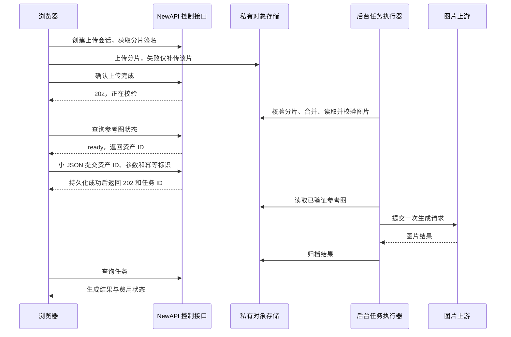

# 图片工作室大图超时专项优化方案

创建：2026-10-17；三角色复核：2026-10-18（北京时间）。对象：用户 4249 暴露出的图片工作室上传与生成超时问题；实现适用于同类用户，不在代码中硬编码该用户。本地实现及定向验收已完成，详见 [实施与验证记录](image-studio-524-verification-20261018.md)；尚未执行本次数据库迁移或生产发布。用户已明确要求：验收后对全部已有图片工作室权限的用户开放，不设置 4249 或其他用户白名单。

## 1. 决策与依据

采用 **私有对象存储分片直传 → 后台校验参考图 → 小 JSON 创建持久任务 → 立即返回 202 → 后台生成并归档 → 页面查询结果**。

同时解决两个问题：大文件不再与生成共用一个 HTTP 请求；生成不再要求浏览器连接一直等待。默认保留原图，不通过静默降低清晰度换取成功率。Worker gzip 不是本专项的主修复措施。

### 已确认的现场证据

用户 4249 的请求 `202610171055476066148368268d9d6wIfRjYu6`：

| 北京时间 | 证据 |
| --- | --- |
| 18:55:47 | 请求进入 `/pg/images/edits` |
| 18:57:49 | 创建生成记录 4404，前置阶段约 122 秒 |
| 18:57:52 | 同时间、路径的边缘连接在 125.009 秒结束，源站记录 499、未收到响应头 |
| 18:58:47 | 生成记录变为 `succeeded`，1 张图片成功，计费 `settled`；应用处理约 180 秒 |

该任务使用渠道 49「Sub2-gpt 生图」。生成及归档阶段约 58 秒。另一个任务 4381，14:15:12 进入请求，14:17:14 创建生成记录，也存在约 122 秒前置耗时；任务 4409 的前置阶段约 22 秒、生成约 42 秒，总计约 65 秒。

证据边界：

- 前置阶段包含接收请求体、multipart 解析、图片校验和临时落盘、用户/token/报价处理、选渠道等；没有历史分阶段时间，不能把 122 秒全部称为网络上传。
- 边缘日志没有与应用共享的请求 ID，上述边缘关联使用时间、路径和请求序列；125 秒无响应头与用户反馈的 524 相符，不把源站 499 直接改写为“源站返回 524”。
- `logs.created_at` 是消费日志经 outbox 落账的时间；本方案使用生成记录的 `started_at/finished_at` 划分阶段，不拿落账时间推算上传耗时。
- 当前工作室通过 multipart 上传文件，公开路径为 `/pg/images/edits`。它不经过当前 `/v1/*` Worker 路由；仅扩 `/v1/images/*` 的 JSON gzip 对它无效。

### 三角色复核后的决策

上传与网络可靠性、分布式任务与计费、最小架构与生产发布三个独立评审均推荐保留主架构，同时反对把原稿直接当作一次完整上线的实施定稿。以下是基于源码和已有现场证据的设计判断，不是直传性能实测或“所有环境下绝对最佳”的证明。

| 备选 | 结论与取舍 |
| --- | --- |
| 只加 gzip／延长超时 | 不作为主修复；没有拆开接收、校验和生成，不能解决离页、断网后的结果找回 |
| 直传＋同步生成／真正 SSE | 页面持续在线时可以更简单，但仍依赖连接与执行进程；不满足本期已受理任务可恢复、计费可靠的目标 |
| 直传＋持久异步 | 当前首选；复用已有任务、存储、outbox、计费与轮询，分别解除上传和生成的长连接依赖 |
| 观测＋只读找回原任务 | 作为可独立交付的第一阶段，降低超时误判与重复下单；不声称已修复 524 |

最终采用两阶段交付：**先做观测与原任务找回，再做通过故障验收的完整异步闭环**。第一阶段不依赖 4249 再次复现。第二阶段先验证浏览器直传路径，再对所有已有工作室权限的用户启用已支持完整计价快照的模型；不增加新消息队列、WebSocket、通用媒体平台或单次 PUT 后复制固化的第二套上传路径。

## 2. 目标与范围

目标是让弱网上传可恢复、任务可追踪，并消除“长时间等生成导致浏览器 524，但后台已出图”的交互故障。目标不是保证上游图片生成本身变快，也不是取消所有网络超时。

设计覆盖图片工作室的生成与编辑；异步路径对全部已有权限的用户开放，但模型必须已验证能恢复完整计价快照。先核实 4249 使用的 `gpt-image-2`，不因当前字段允许空快照就假设已经支持所有计价模式。现有 OpenAI 兼容 `/v1/images/*` 协议保持原有同步/流式语义。图片 JSON gzip 可作为独立小改进，不与本专项的核心验收绑定。

推荐初始指标，均为待验证目标：

- 上传完成确认和生成受理接口在规定负载下 P95 ≤ 2 秒、P99 ≤ 5 秒；不在这些 HTTP handler 内完整下载、解码图片或调用模型。
- 慢上传或生成超过 125 秒时，页面持续显示可恢复的上传/任务状态；生成等待不占用原始提交连接。
- 同一个提交意图只创建一个任务，预扣、结算、退款各遵守现有幂等状态机；上游发送状态不明时不自动再生成。
- 页面刷新、关闭、短时断网和蓝绿切换后，已受理任务可从历史记录找回。
- 原图字节、参考图顺序、透明通道及现有数量/大小/像素限制保持正确。

## 3. 用户流程

页面分别显示上传进度、校验中、排队中、生成中、完成/失败；不把上传 100% 当成图片生成完成。任务受理后离开页面不取消任务。刷新后恢复任务和已验证资产；未完成的上传如需重新选择原文件，应明确提示，不承诺浏览器能凭空恢复 File 对象。

## 4. 参考图上传设计

### 4.1 复用现有基础

复用现有私有 S3/R2 存储、视频工作室的底层 multipart 操作和已安装的 Uppy AwsS3 协议。新增图片业务 API 与权限校验，不让图片功能依赖视频工作室的开关、配额或 ffmpeg。

所有参考图统一使用 multipart：5 MiB 是初始分片候选，上线前与现有视频路径的 8 MiB 对照后确定；图片路径不修改视频的固定分片语义。浏览器全局上传并发初始为 2，弱网可降为 1。小图作为一个末片即可；不另设可在资产校验后继续覆写对象的长期 single-PUT 签名路径。

只做小范围协议复用，不新建通用媒体平台或另引上传依赖。

### 4.2 API 与状态

新增图片专用接口：

| 接口 | 职责 |
| --- | --- |
| `POST /api/image-studio/uploads` | 校验权限和声明大小，分配上传会话、资产 ID 与私有对象位置 |
| `GET /api/image-studio/uploads/:id` | 查询状态、有效期和允许的恢复操作 |
| `POST /api/image-studio/uploads/:id/parts/:part_number` | 为指定分片签发短期上传 URL |
| `GET /api/image-studio/uploads/:id/parts` | 从存储核实已上传分片，支持续传 |
| `POST /api/image-studio/uploads/:id/complete` | 持久保存完成意图及清单，快速返回 `202 validating` |
| `DELETE /api/image-studio/uploads/:id` | 中止未被任务引用的上传，安排清理 |

状态为 `pending_upload → validating → ready`，失败或过期进入清理状态。首次 complete 通过 CAS 冻结分片清单并进入 validating；同清单重放返回当前状态，不同清单返回 409，不能覆盖首次清单或重复创建校验任务。validating 后停止签发分片 URL；旧签名不会因此自动失效，后台必须依据冻结清单和预期内容 hash 验证最终对象。

现有视频 reference image 的完成流程会同步下载完整文件并校验，**不能直接搬用这个完成 handler**。图片 complete 只校验清单格式并在同一数据库事务中写状态和 outbox；后台执行 ListParts、真实尺寸/ETag 核对、Complete、Head、限量读取、SHA256 和图片格式/尺寸校验。

现有 Uppy 视频适配在 complete 返回后直接释放上传预约并生成内容位置。图片适配需要区分 `202 validating` 与 ready，只有查询到 ready 才允许生成；不能把上传 100% 或完成确认响应当成校验成功。

### 4.3 数据正确性与生命周期

- 对象 key 和存储 upload ID 由服务端生成；客户端只使用自己的资产 ID。完成、续签、引用、删除均重新检查 owner 和状态。
- 不相信客户端声明的 MIME、字节数、hash、ETag。复用现有图片读取和限额校验；分片总量、实际对象大小和最终 SHA256 必须一致。
- 续传匹配使用创建会话时冻结的预期内容 SHA256，最终由服务端校验。复用图片前端已有 hash 与顺序批处理；视频续传仅基于文件元数据的指纹不能直接采用。文件名、大小、修改时间只作候选匹配，不能把不同内容拼成一个对象。刷新后重新选择文件并核对 hash，首期不引入新的 hash 依赖或专门 Web Worker。
- 已完成 multipart 的对象视为不可覆写；生成引用绑定到这份已校验内容，避免校验后换内容。
- 上传会话建议初始有效期 1 小时，分片签名 15 分钟；过期续签须重新鉴权。以最大允许体量的弱网实验决定是否调整，不取消期限。
- 未引用的 ready 参考图建议保留 24 小时；活跃任务以及 unknown 核对窗口内绑定的参考图不得删除。任务核对结束、完成结算或退款后依保留策略解除引用并清理，不因用户刷新提前删图。
- 处理中止、过期、合并后崩溃、延迟到达的分片或合并结果均有 tombstone/补偿清理。校验 worker 发布 ready 必须在事务内校验当前领取权与资产状态，不得复活已中止或删除的资产。清理操作可重试，模型生成操作不能套同一重试规则。
- 原图私有；日志不记录图片内容、文件名、提示词、存储签名 URL 或密钥。直传域名的浏览器可达性、CORS、ETag 暴露和分片限制必须在上线前验证。

### 4.4 最小资源边界

现有 `S3VideoAssetStore.PresignUploadPart` 虽接收 `contentLength`，构造签名请求时并未使用它；实际分片大小在后续 ListParts/complete 才核验。因此“声明大小合法”不等于“存储拒绝超大分片”。

- 创建会话时，在主库原子预留每用户未完成会话数与声明暂存字节额度；配额包括未引用 ready 输入，并在实际清理后释放。全局暂存预算同样有界，不新建通用积分/配额平台。
- 上传创建、分片签名和 complete 复用现有限流；校验队列和并发独立设上限，每项有最大字节、像素与读取期限，不能让验证大图堵住账务任务。
- 验证实际 S3/R2 与浏览器路径能否用签名约束拒绝超长分片，不能仅因 SDK 接收参数就认定生效。若尚无硬限制，暂存额度只代表声明量，不能伪称实际字节硬上限；阻止全量启用，补齐硬限制或调整上传方式，并验证未完成 multipart 回收。全量开放前必须明确并处理这项限制。

## 5. 持久异步生成设计

### 5.1 受理接口

新增 `POST /api/image-studio/generations`，使用现有用户认证和图片工作室访问权限。请求为小 JSON：生成/编辑模式、模型与参数、报价凭据、有序参考图资产 ID；header 沿用 `Idempotency-Key`。

沿用现有报价能力，扩展编辑报价入口使其能从当前用户的 ready 资产读取已验证元数据，绑定资产内容、顺序、模型版本和请求哈希。不得只信任前端传来的参考图大小与 hash。

先完成用户鉴权，并按用户、操作与幂等标识查询已有绑定。存在绑定时按已保存的原提交哈希校验内容，相同内容直接返回原任务；不重新要求报价未过期、token 仍可调用、资产仍可新引用或当前队列仍有空位，也不再次预扣。仍须检查当前用户对原任务的访问权。幂等比较使用原提交的资产 ID、顺序、参数等稳定字段，不能因资产已清理而无法计算原提交身份。

只有新的提交进入完整受理流程；以下写入在一个数据库事务内完成，并在事务内处理并发撞到同 key 的情况：

1. 验证当前权限、token、报价有效性、资产归属/状态、模型和总量限制，并检查有界队列容量。
2. 预留/校验幂等标识，创建 generation、绑定参考图、复用现有预扣与计费持久状态，写生成 outbox。
3. 事务提交成功才返回 `202`、任务 ID、`Location` 和 `Retry-After`。任何一步失败不留下“扣了款但没有任务”的状态；缓存更新在提交后执行。

原子范围只包括主库记录；不在事务锁内读取对象或访问模型。现有 `ReserveImageGenerationBilling` 内嵌事务后会立即同步缓存，直接放进外层事务会在真正提交前更新 Redis。需复用并拆出无外部副作用的预扣事务核，真正提交后同步缓存，失败由已有 `image.billing.cache.reconcile.v1` 补齐；不引入数据库与 Redis 的分布式事务。

同 key、同内容返回同任务；同 key、不同内容返回 409。202 响应丢失时，相同小 JSON 和同 key 可找回原任务，不能换 key 自动再下单。排队后的任务使用受理时接受的价格快照，不能因排队导致报价过期后静默换价。

当前 `ImagePricingSnapshot` 可为空；只有额度上限和部分倍率不代表完整计价快照。首轮仅允许能持久化并恢复完整计价规则的模型进入异步路径；其余沿用原入口，待补齐后再扩展。

保留现有 `GET /api/image-studio/generations` 与 `GET /api/image-studio/generations/:id` 查询能力。前端按 `Retry-After` 轮询，后台标签降频；不新增 WebSocket。

### 5.2 执行和恢复

复用 `kkai_image_generations` 作为主记录以及现有 leader/write-job 调度、outbox 租约与 fence，不新增另一套任务中心或消息队列。

现有图片 outbox 主要处理缩略图和删除，**尚无持久生成 handler**。新增独立的图片生成执行 lane，避免长时间出图阻塞计费、删除和缩略图任务。只由具有写权限和有效 leader 租约的执行器运行；serving/candidate 槽不启动后台生成。

新流程内部状态建议为 `queued → preparing → dispatching → result_ready → done`，发送结果不明进入 `unknown`。对外仍兼容既有 `submitting/recovering` 等业务状态，另提供可选执行阶段；旧前端不能因新增内部阶段解析失败。

- worker 下载已验证参考图、准备上游 multipart，在首次发送前重新检查用户、token、组、模型和渠道的安全权限。排队期间撤销权限则不发送并退款；已发送后撤销不改写已经发生的请求，按受理快照归档结算，不再发新请求。查询和原任务重放只检查当前用户访问权，不重新受理。文件下载和图片生成都不在提交 HTTP 请求内执行。
- 上游 POST 前，用当前有效 fence 和任务状态 CAS 持久化 `dispatching`、实际渠道与发送开始时间，提交成功后才发送。
- 现有 outbox 默认错误重试不能直接用于生成。只对确认尚未进入发送边界的准备步骤重试；`dispatching` 后断网、崩溃、租约失效或响应丢失，恢复操作只查已有结果或进入核对流程，不再次 POST、不自动切渠道再生成。
- “已写 dispatching、尚未真正发出”这道崩溃窗口同样保守按 unknown 处理。没有已验证的上游幂等保障，就不宣称跨网络实现 exactly-once。
- 结果先归档并持久保存可恢复资产与计费意图，再幂等结算和更新终态。`result_ready` 的重启恢复只续归档/结算，不重新生成。
- 租约 fence 必须贯穿发送意图、资产绑定、任务终态、计费意图和账务变更；失去执行权的旧 worker 不能覆盖恢复者的结果。现有 outbox fence 仅保护事件本身，不能自动保护这些业务表：每次关键变更须在同一事务内验证当前任务领取权和 leader 租约，再执行变更，不能入口检查后无条件调用旧 helper。对象存储不识别数据库 fence，因此每次领取的输出先写独立、不可变的对象位置，再以当前有效 fence 做数据库 CAS 绑定；禁止新旧 worker 覆写同一个输出 key。绑定失败留下的对象交由孤儿清理，不能发布为用户结果。
- 只保留有界并发、队列和等待时间；初期不提高现有生成并发。每用户排队上限先设 1，超过返回 429；全局容量执行前依据现有限制确定。容量占位必须跨节点原子成立，并与旧同步路径共享预算；现有进程内计数器或事务中单独 COUNT 都不足以防止并发入队穿透，使用主库串行化的容量预留及统一释放规则。

异步执行须在现有请求生命周期策略中区分浏览器断开与 worker 失去执行权。现有图片适配器使用 `context.WithoutCancel`，父 context 取消后可继续等待最长 20 分钟，非零 HTTP client timeout 还可能扩至 40 分钟；不能直接搬用，再按默认 300 秒陈旧任务阈值提前退款。

实施前确定并验证排队、输入准备、上游执行、归档及 unknown 核对各自的期限：上游执行硬期限不得被旧适配器扩长；失权后旧执行器停止业务写入，取消/有界收尾不能重新发请求；新执行器只做核对。unknown 的持久恢复截止与退款互斥规则应覆盖仍可能收尾的执行，不以单一 heartbeat 超时触发退款。具体数值依据渠道能力与故障实验确定，不能混用互相冲突的超时。

没有经验证的上游查询/幂等能力时，核对只检查本地持久化结果及账单；不得承诺能从 Sub2 找回丢失响应。恢复截止仍无可交付结果则退款一次并终结，迟到结果不再收费。首期将终结后的迟到输出隔离清理，不新增免费补领流程。发送前崩溃和收到结果但未持久化的窗口仍可能导致任务无法交付，这是本期明确的协议限制。

### 5.3 现有逻辑必须一起适配

1. **陈旧任务恢复器**：现在会对超时 submitting/recovering 做核对和退款。必须识别 queued、有效租约、dispatching 和 result_ready，避免把正常排队任务误判为失败。
2. **幂等 TTL**：当前过期路径可能直接删除绑定记录。活跃任务及 unknown 核对期间不得删除；终态采用明确保留期，防止同意图重复扣费和生成。
3. **计费**：复用现有预扣、按可交付结果结算、退款 CAS 与计费 outbox；需要支持受理事务，而不是复制一套计费代码。worker 从已预扣的持久记录恢复计费会话，不能再次预扣。准备失败/排队超时退款一次；未知结果先在有界恢复窗口核对，无法交付时依现有原则退款一次。迟到结果不能再自动扣用户一次钱。
4. **执行上下文**：将 controller 中的生成、归档和结算流程收敛为可由后台调用的服务；不能把请求结束后失效的 Gin context 交给裸 goroutine。复用 relay 适配与必要的内部上下文构造，不另写图片渠道实现。也不能直接从 worker 调用包含渠道重试、失败自动退款的整个旧 `Relay` 包装器；异步发送和 unknown 收尾必须按新状态边界执行。

## 6. 最小数据与代码改动

实际实现采用 v10 的三张附属表，保留 v9 既有资产与生成表形状，使关闭新准入的兼容版本可在迁移前运行。本次已独立确认线上迁移账本为 v9；不涉及认证迁移。

| 位置 | 变化 |
| --- | --- |
| `kkai_image_assets` | 复用既有字段表达 reference 类型和上传/校验状态；参考图不进入输出图库和成功张数统计 |
| `kkai_image_reference_uploads` | multipart 会话、分片大小、上传意图键、冻结清单、过期/清理时间 |
| `kkai_image_generation_references` | generation、asset、position；保证顺序、归属和引用期防删除 |
| `kkai_image_executions` | 内部执行状态、领取围栏、事件 ID、请求与价格快照、发送渠道/时间、上游 request ID 和各阶段截止时间；没有附属记录的任务走旧同步恢复规则 |
| `image.generate.v1` outbox payload | generation ID；完整版本化执行数据保存在 execution 附属表，不存密钥或 base64 大图 |
| 存储与上传 | 小范围扩展图片 store 接口，复用 S3 multipart 底层实现与 Uppy 协议 |
| 图片服务、后台任务、幂等及计费 | 新受理事务、受控执行、恢复规则、引用清理和活动幂等保留 |
| 图片工作室前端 | 上传/校验/任务状态、资产引用提交、刷新恢复、同 key 找回任务；所有新增文案覆盖当前七种 locale（含 zh-TW） |

迁移必须兼容 SQLite、MySQL、PostgreSQL；优先 GORM 和现有锁封装。属于明确的 schema 变更，不以应用镜像发布暗中执行迁移；执行前按实际线上版本选择专用迁移手册与契约。

## 7. 先补齐能说明问题的观测

第一阶段增加元数据级的原任务找回：用户鉴权后，按固定 `image.submit` 操作与 header 中的 `Idempotency-Key` **只读**查询现有绑定，已绑定则返回现有 generation view；不重传图片，不调用会删除过期记录或新建预约的 `ReserveIdempotencyKey`，不新增业务表。接口不依赖旧报价仍有效或原文件仍在浏览器中。

未绑定或查无记录仅表示“尚未确认”，不能解释成没有发送：旧入口可能还在接收图片，尚未创建预约。前端保留原 key，引导查历史或继续确认，不能自动换 key 下单。现有 `/pg/images/edits` 的同 key 重放仍会先解析整个 multipart，因此仅复用旧提交接口不算完成这项优化。此阶段降低误判和重复下单风险，不宣称已消除 524。

保留原 `use_time` 口径，新增阶段数据，不更改历史含义：

- 旧入口：请求开始、请求体读取完成、multipart 完成、图片校验完成、generation 创建。
- 上传：创建/完成/校验时间、实际字节、片数、恢复次数和校验结果。
- 任务：受理、领取、输入准备完成、发送意图、`httptrace.WroteRequest`、上游响应头、输出归档、结算和终态。
- 按 request/upload/generation ID 关联；只记大小、耗时、阶段、状态和必要用户/渠道标识，不记内容和完整请求头。

区分“写入发送意图”“开始调用 HTTP client”和“请求已写完”。不能拿函数入口证明上游已收到，也不能把入账时间当成生成完成。

## 8. 验收方案

先做本地故障注入和定向回归，再做少量经授权的真实渠道验收。体量包含小图、20/32 MiB 单图、接近实际总上限的多图；使用自有或合成合法图片，不使用客户原图。

| 场景 | 必须结果 |
| --- | --- |
| 上传限速、丢包、断网、刷新 | 已完成分片保留；只补传缺片；原图 hash 和参考图顺序不变 |
| 总上传或生成超过 125 秒 | 控制接口短响应，页面通过状态查询继续；不依赖一条连接撑完整流程 |
| complete 重复、响应丢失、后台重启 | 一份资产、一个校验过程的幂等结果；不会把完整校验搬回 HTTP handler |
| complete 不同清单重放、旧签名续写、校验与 abort/GC 竞争 | 清单冻结；最终内容匹配预期 hash；已中止或删除的资产不能被发布为 ready |
| 超长分片、过多会话、校验积压 | 核实存储端大小约束的实际效果；会话与声明字节占位原子有界，异常实存可检测并回收，校验不堵塞账务 |
| 同 key 并发提交、202 丢失 | 同一 generation，最多一次预扣；不同内容冲突 |
| 旧上传仍在进行时只读找回 | 不重传原图，不创建预约；未观察到不等于未发送，不自动换 key |
| 已受理后报价过期、token 撤销或资产被清理再重放 | 经用户访问权和原提交身份校验仍返回原任务，不重复受理或预扣 |
| 事务中任一步失败、外层提交前回滚 | 不存在孤立扣费、无事件任务或错误资产绑定，Redis 不提前出现扣款 |
| 两台 serving 用不同 key 同时入队，旧同步与新异步并行 | 用户和全局容量不被穿透，共享预算正确释放 |
| queued/preparing 重启 | 依据持久记录恢复；资产仍可读取 |
| dispatching 重启、上游响应丢失 | 不发第二个模型 POST；明确展示待核对状态 |
| 归档后重启、结算重放、迟到结果 | 不重复生成，不重复扣费，资产和账单状态一致 |
| 旧 worker 在失去租约后完成对象写入 | 独立对象不能覆盖已绑定结果；过期 fence 不能绑定资产或修改账单，孤儿最终清理 |
| token 在排队时撤销、价格变化、资产过期/越权 | 撤销后未发送任务零模型 POST、退款一次，原 key 可查回；价格变化不影响已受理快照，不支持完整快照的模型不能进入异步 |
| 执行硬期限、失权、unknown 核对截止与迟到结果 | 旧 20/40 分钟生命周期不能覆盖新期限；失权不能改账，退款后不能再扣费或重发 |
| abort/GC 与任务绑定并发 | 引用中的资产不删除；未引用的过期对象最终可清理 |
| 灰度停止与蓝绿切换 | 停止新受理后，兼容 worker 继续收尾；候选槽不抢执行权；常规 writer 替换前有后台任务 drain 证据 |
| 启用新任务后的正式回退 | 实际 rollback writer 能继续查询、执行及核对新任务；不能仅证明当前活动版兼容 |

定向验证范围包括图片 controller/service/model、幂等/计费/outbox 的受影响行为，以及上传协议和图片提交前端测试。覆盖直接依赖，不用全仓测试代替上述故障场景。跨数据库变更需要三种数据库的相关迁移与事务验证。部署基础设施发生实际改动时执行其强制策略门槛；全套或预计超过 5 分钟的检查按仓库授权规则安排。

性能对照分开报告上传、校验、排队、生成和归档，不能套用此前文本 gzip 的 44%–48% 数据。小样本只报告原始分布；真实上游成功率和生成时长不能由本地模拟器替代。

## 9. 实施与上线顺序

1. **独立止损阶段**：增加阶段记录与只读 by-key 找回，前端对未知提交结果保留原 key，不自动换 key 再生成。此阶段可先交付，不依赖完整异步 schema；按实际改动范围执行发布门禁。
2. **上传路径验证与实现**：先用自有图片验证浏览器直传可达性、CORS/ETag、超长分片限制以及 5/8 MiB 弱网对照，再完成私有分片直传、后台校验、引用资产与清理。不把直传更快当作已证实的前提；路径不达标则先调整存储接入方式，不直接开放。
3. **异步受理与执行**：完成原子任务受理、预扣、后台生成、恢复和前端查询；完成断网/重启/重复提交故障验收。
4. **兼容底座与回退对**：先部署能理解并保护新状态、但关闭新受理的 backend/writer 版本。实际活动与正式回退目标的 writer 均兼容后，才启用新任务。第一轮兼容发布通常仍回退到旧版，不能立即开灰度；可由底座版到功能版的两次正常发布形成兼容对，或采用执行时已验证受支持的正式流程，不手改回退指针。v9→v10 迁移前，两槽必须已是相同规范契约的 `(9,10,9)` 兼容版本；再按专用 schema 门禁创建并验证快照、执行独立授权的 v10 迁移。
5. **全用户启用**：完成内部验收后，统一设置 `image_studio.async_submission_enabled=true`，对所有已有图片工作室权限的用户生效，不增加用户白名单。模型级能力仅由完整计价快照支持决定；不满足条件的模型保留既有入口。生产发布仍走正式 stage、候选验收、10%/50%/100% canary、promote、错误窗口及回退门槛；发布流量 canary 不等于用户白名单。

由于存储、schema、后台 writer 和前端均有变化，这是组合发布，不能当作只改 Worker 的小补丁。前端 artifact 与后台契约按执行时已验证的格式和控制器能力发布。

### 正常发布的后台任务排空

现有应用退出时取消后台任务并最多等待 10 秒；部署器对 serving 入站连接的排空不等于 writer 后台生成排空。不能每次正常更新都依赖 unknown/退款补救。

任何替换具有生成执行权的 writer 的正常发布步骤，必须先停止新领取，保持 leader 续约并让已领取任务完成有界收尾，再取得没有在途生成/归档/结算的 drain 证据，最后替换 writer。queued 任务继续持久保留，由新 writer 接手。超过排空期限则停止发布推进并诊断，不强杀后宣称排空成功。现有控制器若缺此能力，应先按基础设施规则实现和验收其正式集成；不另起旁路部署命令。突发崩溃或不可避免的失权仍走 unknown 恢复规则。

### 回退

先关闭新上传/异步受理开关，保留查询、校验收尾、生成执行和归档结算；已接任务不丢，已上传输入不删除。

新任务启用后，最低回退基线必须是能理解新任务状态的兼容版本。**不能直接回到当前旧 writer**：旧陈旧任务恢复器可能把新 queued 任务当成失败并退款。需要回到更早版本时，先排空或受控隔离新任务并核对账单；保留新增 schema 和对象，不做反向删表/清空队列。

## 10. 相关代码与本次交付

- [现有工作室提交与前置处理](../../controller/image_studio_relay.go)
- [图片任务与资产模型](../../model/image_studio.go)
- [图片任务创建与恢复](../../service/image_generations.go)
- [现有图片后台任务](../../service/image_runtime_jobs.go)
- [outbox 执行和租约](../../service/kkai_outbox.go)
- [幂等记录](../../service/idempotency.go)
- [图片计费状态机](../../model/image_billing.go)
- [图片私有存储](../../service/image_asset_store.go)
- [可复用的 S3 分片底层](../../service/video_asset_store_s3.go)
- [不可直接照搬的同步完成流程](../../service/video_multipart_completion.go)
- [现有浏览器上传协议](../../web/default/src/features/video-studio/video-upload-protocol.ts)
- [现有图片内容 hash](../../web/default/src/features/image-studio/image-reference-metadata.ts)
- [现有图片工作室 API](../../web/default/src/features/image-studio/api.ts)
- [现有图片执行生命周期](../../relay/channel/api_request.go)
- [现有进程内提交容量](../../controller/image_studio_capacity.go)
- [现有退出等待](../../main.go)

本次交付为专项方案文档和源码核对。未执行模型业务请求，未修改线上路由、Worker、数据库或运行时配置；不把本方案描述的能力当作已经上线。

## 实现参数与尚待验收

- 生成队列总量默认 32；每用户仍遵守现有并发上限。生成执行使用独立 outbox lane，上传校验独立并发 1、最多 64 个待校验上传。
- 分片 5 MiB；签名把实际 `Content-Length` 纳入校验，前端用 Blob 自动发送长度，不设置浏览器禁止的头。
- 排队截止 10 分钟；准备与上游执行共享 20 分钟硬期限；归档最多 2 分钟；未知结果额外保留 2 分钟恢复窗口。后端取消不能被旧图片的延长等待策略忽略。
- writer 用 SIGUSR1 停止新领取但保持续租；受控状态文件绑定进程与容器身份，inflight=0 后才可替换；SIGUSR2 恢复领取。后台退出排空上限为 24 分钟，失败不得直接当作已排空。
- 全量开放前仍须取得真实 R2 超长分片拒绝、浏览器 CORS/ETag、ListMultipartUploads/Abort 权限及应用异步闭环证据。不能用本地 mock 测试冒充已上线或证明真实大图延迟下降。
