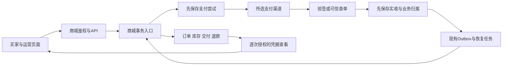

# KK 商城开发总纲

版本：D2，2026-10-28。状态：首版应用代码已落地，已完成本轮本地定向验收；未安装商城 schema、未启用收款、未部署。实际代码范围与验证证据见[实施状态](./kk-shop-implementation-status.md)。

D1 规格核对基线为 `4a8631002`。本轮应用实现承接 `production/kkrich` / `1ead6eb1fccbdc766b009aab755237d6f41d220e`，商城改动保留在工作区，未提交。保留视频发布已有代码及后台任务注册；测试仅使用隔离 fixture，不创建真实交易。

## 1. 开发依据与唯一职责

| 文档 | 定义内容 |
| --- | --- |
| [产品需求](./kk-shop-prd.md) | 18项需求、11个页面、24条产品验收，以及尚未确定的经营输入 |
| [交易与业务规则](./kk-shop-business-rules.md) | 40条业务验收，付款、库存、交付、售后和退款的事实边界 |
| [UI 规格](./kk-shop-ui-spec.md)、[V2设计稿](./kk-shop-design-preview.html) | 页面布局、浅深色主题、交互、演示状态与原创图片；设计不作为资金事实来源 |
| [API 开发契约](./kk-shop-api-contract.md) | 唯一对外路径、DTO、金额/时间、版本、动作、错误码及请求保护规范 |
| [后端开发规格](./kk-shop-backend-development.md) | 模型与索引、事务/锁序、渠道接入、恢复任务、加密及迁移兼容 |
| [前端开发规格](./kk-shop-frontend-development.md) | 11页与真实路由接点、组件/状态边界、插画/主题、i18n、秘密处理及交互验收 |
| [质量与验收规格](./kk-shop-quality-and-acceptance.md) | 需求追踪、确定性故障/并发/权限测试、三数据库兼容及分阶段门禁 |
| 本文 | 跨角色决策、依赖顺序、任务完成定义、上线配置及评审结论 |

业务正确性以 PRD/业务规则为准，具体协议以 API 契约为准，视觉以 V2 UI 规格为准。实现发现矛盾时修订对应权威文档和关联用例，不在前端、后端、mock 各保留一套相似规则。

商城文件、路由、模型及证明 scope 已有应用实现；章节中的验收要求不自动等于验收通过。运行中的生产版本、渠道能力与 schema 安装状态仍需独立证据。

## 2. 角色评审的落地决定

| 角色 | 负责判断 | 本次决定 |
| --- | --- | --- |
| 后端与支付架构 | 收款能否安全复用、持久化、并发、故障恢复 | 复用现有单个渠道的传输/验签基础；新增商城核销，独立于 TopUp、quota、赠额、充值返佣 |
| 前端架构与交互 | V2转组件、登录/主题融合、状态与秘密处理 | 公共布局承载买家页面，后台承载运营；服务端状态驱动动作；秘密只在受控组件内存中短暂展示 |
| QA与安全 | 交易竞争、退款争议、跨用户/跨站、三DB、验收可执行性 | 全部REQ/AC/BR有追踪；原充值交叉回调、用户删除并发及schema兼容纳入首版门禁 |
| 集成主审 | 契约一致、任务可拆解、范围与代码质量 | 统一API、版本归属、政策结构和证据语义；技术方案不写死未知运营配置，不引入第二套商城框架 |

### 2.1 架构决策记录

| ID | 决策 | 采用原因与边界 |
| --- | --- | --- |
| ADR-01 | 同仓、同进程、同数据库的独立shop模块 | 保持现有Go/Gin/GORM与React架构；库存/订单事务无跨服务一致性成本 |
| ADR-02 | 首版单商品、单规格、单件、直接下单 | 满足自营虚拟商品；没有购物车、物流、SKU组合、促销/租赁平台 |
| ADR-03 | 订单、支付尝试、可信实收、交付版本、退款责任分离 | 一笔钱不等于一次交付；迟到/重复/未匹配实收仍可追踪；领取不分配库存 |
| ADR-04 | 最小货币单位int64，对外十进制字符串 | 避免浮点金额、JS精度与quota换算；普通商品款全额退款，原路人工执行和核实 |
| ADR-05 | 数据库唯一约束+事务CAS保护，outbox负责恢复 | Redis/leader/按钮禁用不是正确性根；使用现有持久任务，不新增MQ或通用工作流平台 |
| ADR-06 | 会话、主站、所有权与敏感证明分别校验 | UserAuth/管理员角色不能替代session-only与具体对象归属；管理员查看秘密须显式动作 |
| ADR-07 | V2素材与语义主题复用，前端feature模块内聚 | 保留原创视觉、深色与移动体验；不移植单文件原型的模拟状态机，不创建新的设计系统 |
| ADR-08 | 增量schema与兼容门禁先于真实交易 | 不把启动AutoMigrate当生产发布；旧版本必须能承接存量任务，不能只关闭商城入口再回退 |

GitHub项目继续作为流程和模型参考，来源及许可记录在[实现方案](./kk-shop-implementation-plan.md)。没有引入外部电商运行时；将来直接移植源码须重新核对具体版本/文件许可和项目归属要求。

### 2.2 数据流与责任

外部网络不放在数据库锁事务内。浏览器回跳不连接“付款成功”写路径；管理员没有“手动已付款”后门。先保存资金事实、后驱动业务，无法履约进入有责任人的异常，不丢钱也不再收费。

## 3. 实际源码接入清单与不可误用的基础设施

| 现有接点 | 开发要求 |
| --- | --- |
| [钱包路由](../../router/wallet_payment.go)、[网关](../../service/wallet_payment_gateway.go) | 原生命周期与会话创建依赖TopUp和充值语义；只在选定渠道处提取确有两个调用者的参数/校验，原充值入口保持行为兼容 |
| [充值核销](../../model/topup_finalize.go) | 商城不得调用该额度/返佣核销路径；交叉投递不能在任一业务误入账 |
| [可信收款](../../model/wallet_payment_receipt.go) | 复用先存钱款事实再核销的模式，不能将商城硬塞入带TopUp约束的表 |
| [持久任务](../../service/kkai_outbox.go) | 注册shop handler、唯一事件键、幂等恢复和责任队列；payload只有必要引用 |
| [鉴权](../../middleware/auth.go)、[钱包写保护](../../middleware/wallet_payment.go) | GetSessionAuthIdentity判断真实会话；钱包MutationGuard允许PAT，商城需自己的严格会话/主站/Origin组合 |
| [强认证服务](../../service/security_verification.go)、[证明消费](../../middleware/secure_verification.go) | 当前没有shop作用域；必须补构建/归一化/权限/消费/前端类型，不能只挂channel专用中间件 |
| [管理员审计](../../middleware/audit.go) | 现状不落请求正文，有限响应内存缓冲只用于判断success；新敏感接口显式记录对象/动作/结果，验证不会把明文放入日志、错误或审计 |
| [用户责任检查](../../model/tenant_consumption.go) | checkTenantUserDeletionTx目前对主站提前返回；商城下单与全部软删/硬删入口必须共用账户栅栏与一致锁序 |
| [schema门禁](../../pkg/kkaimigrate/schema_wallet_payment.go)、[runtime契约](../../pkg/kkaimigrate/contract.go) | 本地只读门禁已接受已知 canonical schema19，旧写入 proof 保持冻结；真实 PostgreSQL 演练验证钱包数据和门禁保留。生产采纳仍需独立迁移/回退门禁 |
| [前端请求](../../web/default/src/lib/http-client.ts)、[钱包纯金额格式](../../web/default/src/features/wallet/lib/payment-flow.ts) | 复用现有会话刷新与请求基础、准确金额格式；证明请求不得自动消耗第二次，商城不借用钱包业务状态hook |

现有会员、发票、分销和额度系统不自动接纳商城订单作为可计费/可开票/可返佣来源。需要新增接入时另列业务规则与验收；首版不要通过伪造TopUp获取这些能力。

## 4. 可分配工作包与依赖

每包交付：代码与必要文档、对应确定性测试、实际验证命令/结果、剩余限制。表中的完成标准是开发要求，当前均未执行。分批实现只用于内部联调，首版对客开放必须同时完成自动/人工交付和全部P0/P1。

| 工作包 | 主责 / 依赖 | 具体交付 | 合并前完成标准 |
| --- | --- | --- | --- |
| DEV-01 契约与首发渠道核验 | 集成+支付 / 无 | 冻结API DTO/fixture；记录渠道method、商品类目、币种/指数、商户/环境、幂等创建、按原号查单、关单、ACK与人工退款核验步骤 | 渠道未知能力保持关闭；协议 fixture包含202、409、金额边界和无权对象；不拿演示渠道联调真实钱款 |
| DEV-02 schema、安全与会话边界 | 后端+安全 / DEV-01的领域契约 | shop模型/索引/迁移catalog/运行时门禁，用户栅栏、加密用途/密钥版本、主站会话及证明作用域、DTO白名单 | 三DB约束可执行，钱包门禁兼容，秘密不被持久日志记录；不执行生产迁移 |
| DEV-03 目录、草稿与库存 | 后端+管理前端 / DEV-02 | 分类/商品草稿及发布检查、快照政策、导入预检/整批确认/隔离、人工容量与限购配置 | 草稿不能成为可付款演示商品；重复导入/预检到确认竞争全成或全拒；无明文批量导出 |
| DEV-04 下单与可信支付 | 后端支付 / DEV-01、02、03 | 唯一订单、预留、先存尝试、原入口恢复、查单/回调、可信实收/差错、持久恢复、取消/到期与迟到款 | BR-01至14、35、39涉及路径通过；额度及返佣不串；真实故障不会丢收款或重复履约 |
| DEV-05 人工与自动履约 | 后端+运营前端 / DEV-04 | 人工队列/资料/SLA、首次交付、自动分配、揭示/复制、期限/解密异常、通知 | 两种交付均通；交付幂等，秘密仅本人可领；通知失败不二次发货；不能拿已读当验收有效 |
| DEV-06 售后、补发与资金责任 | 后端+运营前端 / DEV-05 | 售后追加记录、风险暂停/恢复、补发版本、退款责任/尝试/证据、外部调整/争议、独立差错队列 | 退款与交付并发、失败/未知区别、额外款隔离、到期后补发窗口及防重复退赔全部通过 |
| DEV-07 买家与管理UI集成 | 前端 / DEV-01后可用fixture并行，完成依赖DEV-03至06 | PAGE-01至11、导航、V2 WebP、浅/深色、表单/弹层、登录回跳、错误/空载、i18n及后台待办 | UI不含原型工具条/假成功；320/390/1440、键盘、200%缩放与实际启用语言验证；读取秘密不进Query缓存 |
| DEV-08 账户、恢复、清理与运营可见性 | 后端+QA / DEV-04至06 | 软/硬删与并发保护、禁用承接、暂停新单仍处理存量、任务死信与未结责任、加密资料保留/清理 | BR-29、34、37、38、40；账户/入口/凭据到期不清除债务；主密钥丢失保持可处理异常 |
| DEV-09 联调验收与发布交接 | QA+各模块负责人 / 前述完成 | 全追踪矩阵证据、原充值定向回归、三DB并发、受控渠道联调、视觉复核、迁移/回退交接材料 | 未完成项清楚标为阻塞；满足现行发布手册后才可申请/执行另行授权的真实发布 |

前端可先实现不含真实付款/秘密的组件与fixture；不必等待全部后台完工。自动库存的设计与开发可和人工UI并行，但资金确认及资格判定必须共用一次实现。

## 5. 代码质量的具体约束

### 5.1 模块和接口

- Go遵循Router → Controller → Service → Model：controller只做身份、输入/输出及错误映射；service编排渠道/加密/任务；model承载数据库事务与状态不变量。不要把“已付款”分别写在回调、管理员与worker中。
- 实际副作用使用有业务含义的操作，如创建订单、确认可信实收、提交交付、批准退款。禁止通用 `UpdateStatus(any)`、任意map批量更新和能从API写入财务事实的后台字段。
- DTO独立于DB模型，入参白名单；使用项目common JSON包装、GORM与`lockForUpdate(tx)`。不新增“万能Repository”、事件溯源框架、动态表单/规则引擎或重复支付SDK。
- 新抽象必须有真实复用方或稳定业务边界。先支持选定一个渠道，只提取共享I/O与验签，不一次重写全部支付适配器。
- 数据库是库存/订单/退款的权威；内存锁、Redis、leader锁只能优化调度。所有CAS检查RowsAffected；死锁/SQLite busy只有限重试完整事务，失败可查证，不偷偷换key。
- 不依赖MySQL部分唯一索引或CHECK执行能力；以可跨SQLite、MySQL5.7.8+、PostgreSQL9.6+的约束、根对象活动引用和事务实现唯一活动项。

### 5.2 前端及秘密

- 使用现有Base UI、Hugeicons、TanStack Router/Query、RHF/Zod；功能放feature内。服务端事实留Query，UI状态就近组件管理，不建商城全局状态机复制数据库。
- `allowed_actions`改善体验但不承担授权。列表只用脱敏DTO；完整资料/秘密单独读取。领取/复制在每次服务端授权后执行，登出、换用户、换版本、到期、离页或请求过时清空，不靠遮罩CSS保存旧DOM。
- 有独立数据源的请求可以并行；首屏只加载必要素材；不要把后台管理、图库和九张母图打入商城首页首屏包。使用现成WebP尺寸和lazy loading。
- 文案采用实际项目启用的flat English source keys，中文商品描述是数据，不作为翻译key；当前包含zh-TW，不能照旧“六种语言”说明遗漏它。
- 消息/商品文本按文本输出；不用危险HTML承接运营输入。跨主题和移动端适配使用语义token，不通过反色滤镜把插画改暗。

### 5.3 评审与完成定义

每包由非作者角色至少完成一次针对性走查：付款/退款改动由支付或安全审查，数据迁移/并发由后端与QA审查，买家流程由前端与产品行为交叉审查。代码评审不以文件行数或覆盖率百分比代替判断。

完成必须能回答：正常路径得到什么可观察结果；并发重放是否增加钱/货；进程在哪一步崩溃如何恢复；对象是否属于当前用户/主站；秘密会出现在哪些响应/日志；新schema和旧充值如何兼容。真实行为测试优先于大快照、随机循环、sleep及私有实现断言。

新/重写Go测试遵守require用于setup/fatal、assert用于结果；并发测试用可控barrier/故障注入，时间逻辑用注入时钟，不能靠等待真实15分钟或偶然时序“证明”正确。

## 6. 运行、监测与发布交接

### 6.1 恢复与可见性

后台必须分别查询：未匹配/异常实收、未知支付尝试、已付未交付、人工超期、失败交付、活动售后、退款待核实/失败、未决争议及低库存。每个待办有对象引用、原因、责任人、最近进展和下一步；不只提供红色数量。

记录低基数计数和时间：支付未知积压、实收至交付延迟、人工超期数量、退款未结时长、outbox重试/死信、解密失败。日志关联order/receipt/event的非秘密引用，禁止将用户信息、完整商品凭据或每个订单号当指标label。告警阈值由运营确定，不写虚构SLA。

任务重试耗尽不能把责任标完成；转人工队列后仍可有理由恢复同一任务。凭据过查看期停止返回，清理作业另按保留政策与未结责任决定；订单/收款/退款事实不随秘密清理删除。备份恢复同时需要数据、对应密钥版本和经过验证的恢复步骤。

### 6.2 正式启用前必须具备的输入

| 输入 | 决定者 / 最晚时点 | 缺失时行为 |
| --- | --- | --- |
| 首批商品、来源及实际交付字段 | 运营 / 模板与商品上架前 | 仅草稿，演示资料不得入生产库存 |
| 一个首发渠道、商户/环境、类目许可、币种/指数、真实查单和人工退款核验步骤 | 支付负责人+运营 / 该渠道实现及联调前 | 关闭真实付款；使用隔离fixture推进其他开发 |
| 售价、交付SLA/时区/工作时段/容量、条款和商品有效期 | 运营 / 上架前 | 发布校验拒绝，不填演示默认 |
| 预留期限、未付款单限额、质保/退款/查看时长 | 运营 / 交易验收前 | 参数不完整不开新单；历史订单仍按已存快照 |
| 密钥管理、备份/恢复、凭据和个人资料保留策略 | 运维+安全+运营 / 真实库存导入及上线前 | 禁止导入/交付需要的秘密写入，不用临时随机密钥替代 |
| 处理责任人、异常与退款核实阈值 | 运营 / 首笔真实交易前 | 不开放无人承接的付款能力 |
| 最终UI审核 | 用户 / 正式页面实现收敛前 | 当前V2为开发参照；暗色保留纸艺暖色插画，不擅自新增付费生图 |

文档继续完善不需要先获得这些输入；它们约束具体实施/启用节点，不作为停止本轮交付的理由。

### 6.3 发布边界

schema变更和正式部署另遵守 `/Users/tokk/Documents/Codex/runbooks/newapi-upgrade-and-deployment.md`。本轮为本地 backend/combined + schema 代码开发，不查询可变生产状态，不构建发布镜像、不改 controller pin、不运行生产迁移。开发实现不能授权生产变更。

已在当前 catalog 分配 schema 19，共 16 张新增商城表；应用要求 canonical ledger 回执，普通 CLI 不开放直接应用 target 19。发布前仍须逐一核对 runtime contracts、canonical digest、扩展回执及受影响功能门禁。选定精确目标源码和实时只读DB证据后才决定build profile。schema扩展仍需单独明确授权。

回退版本不仅要能读表，还必须理解商城资金/恢复/交付任务。若旧leader不识别shop topic，暂停新单并不能解决未结款；需先准备兼容的责任承接版本/运行方案。格式2前后端兼容与候选环境是否安装，以实际发布手册和届时证据为准。

## 7. 本轮开发规格走查与修正

| 编号 | 查出的缺口 | D1处理 |
| --- | --- | --- |
| D-01 | “复用支付”容易被实现成TopUp充值核销 | 明确商城独立model事务、可复用渠道I/O和跨业务回调验收 |
| D-02 | UserAuth与钱包Origin中间件并不等于session-only | 明确主站会话门禁、对象归属及新增shop证明作用域 |
| D-03 | 增加schema可能让钱包精确版本门禁失效 | DEV-02和QA加入schema兼容、现有充值回归及回退任务能力 |
| D-04 | 自动审计是否有秘密泄漏缺少源码证据 | 已核实当前只落元数据；要求新接口无正文持久化且做脱敏验收，未声称现状存在泄漏 |
| D-05 | API政策字段只是文字，无法实现SLA/期限计算 | 增加结构化SLA、工作日历、查看/质保/权益/退款政策及快照版本 |
| D-06 | 嵌套退款动作和管理员揭示的version归属不清 | 固定退款责任/收款/订单/库存根对象版本，所有敏感证明绑定精确目标 |
| D-07 | 人工证据可能被误用成“管理员填成功即退款成功” | evidence仅材料；verify另核实身份/金额/来源及冲突，无法核实仍unknown |
| D-08 | 确认购买与已有订单支付混成一个路由容易先建单后读条款 | PAGE-03拆同功能的确认页和既有订单付款页；先读并确认条款，再建单 |
| D-09 | 下单/导入已提交但响应丢失，刷新后缺对象号 | 按原actor/作用域/幂等key提供只读结果定位，not_observed不作为原动作失败证据，不自动换key重做 |
| D-10 | 证明context与秘密幂等HMAC混淆，浏览器无法生成服务端摘要 | 操作证明绑定精确对象/版本/非秘密字段；全文幂等HMAC只在业务端生成，不增加秘密预授权服务 |

## 8. 本轮验证范围

D1 的文档静态检查保留在[质量文档](./kk-shop-quality-and-acceptance.md)第 10 节。D2 另执行商城模型、服务、路由、权限、schema 及前端的定向检查，精确命令与结果统一记录在[实施状态](./kk-shop-implementation-status.md)。

全仓测试、lint、typecheck 与生产 build 均跳过；采用受影响范围的定向检查。真实渠道、MySQL/PostgreSQL 实例、真实 React 浏览器完整流程及生产安装仍为验收缺口，不能以单元测试或原型截图替代。
