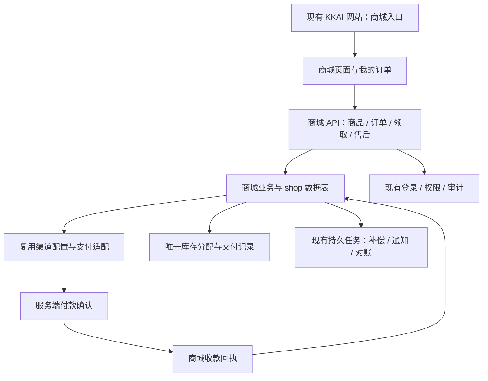

# KK 商城：需求评审与推荐实现方案

评审日期：2026-10-27。源码基线：本地 `production/kkrich`，提交 `4a8631002`。

本方案已展开为可审核的产品文档与设计交付，入口见 [产品与设计审核](./kk-shop-review.md)。产品范围和具体行为以 [PRD](./kk-shop-prd.md) 及 [业务规则](./kk-shop-business-rules.md) 的明确条款为准；本文保留选型与架构依据。

2026-10-27 已进一步展开为[开发总纲](./kk-shop-development.md)、[API契约](./kk-shop-api-contract.md)、[后端规格](./kk-shop-backend-development.md)、[前端规格](./kk-shop-frontend-development.md)与[质量验收](./kk-shop-quality-and-acceptance.md)。下文逻辑模型和阶段保留为方案概述，字段、端点、并发及执行依赖按详细规格实施。2026-10-28 已形成首版本地代码，见[实施状态](./kk-shop-implementation-status.md)。

本文由产品、应用架构、支付与交易安全三个并行评审视角汇总，并结合当前仓库源码和 GitHub 项目资料形成。本文保留方案设计时的选型依据；当前实现情况另记。源码能力不等于生产已安装或支付商户已启用的能力。

## 1. 已确认的需求与推荐结论

用户已确认：单商家自营；销售账号、卡密等虚拟商品；同时支持自动发货与人工交付；在现有 KKAI 网站增加商城入口；复用本项目的支付系统；不需要物流。

推荐在现有 Go 后端和 React 前端中增加独立的商城业务模块，共用登录、支付渠道配置、后台权限、审计及任务基础设施。商城拥有自己的订单、库存、交付、付款记录及售后记录。前台使用适合购物的页面布局，管理功能进入现有后台。

这条路线最符合目前的经营模式：省去第二套账号、支付同步、跨服务对账和部署体系，同时能够用同一数据库事务保护库存与订单。以后确有独立团队或故障隔离需求时，可沿商城 API 和数据边界拆分。

关键判断：当前支付系统主要服务于钱包充值。可以复用支付渠道和可靠性设计，但需要新增商城支付接入，不能只把充值页面改成商品页面。

## 2. 三个角色的评审结果

| 评审角色 | 核心判断 | 对方案的具体影响 |
| --- | --- | --- |
| 虚拟商品电商产品负责人 | 难点是付款后的正确交付与售后。账号还会发生绑定、失效、找回等状态变化 | 商品必须明确交付内容、适用地区、使用条件、质保范围；首版完成补发和退款处理闭环 |
| 电商应用架构师 | 现有账号、权限、数据库、任务能力已经足够；引入整套商城会增加重复系统 | 同仓、同进程的独立业务模块，遵循现有 Router → Controller → Service → Model 分层 |
| 支付与交易安全架构师 | 充值核销会增加 API 额度并可能触发返佣；付款成功与交付成功必须分开 | 商城独立付款与履约记录；数据库防重；账号凭据加密；不使用 API quota 支付商品 |

评审中的取舍：首版每个可售商品对应一种规格，每单购买一件。不同期限、地区或版本先作为不同商品展示。这样可以满足销售需求，同时避免提前建设购物车、拆单、部分退款和复杂规格组合；确有批量采购需求后再扩展。

## 3. GitHub 参考项目与采用方式

以下为 2026-10-27 实际读取仓库元数据、README、许可证及部分发布/目录资料后的对比。此次没有对这些项目进行完整安全审计，也没有部署试用；活跃度和 Star 数不能证明交易实现可靠。

| 项目 | 适合参考的部分 | 与当前项目的关系 | 建议 |
| --- | --- | --- | --- |
| [Dujiao-Next](https://github.com/dujiao-next/dujiao-next) | 专注数字商品，具有 cardsecret、fulfillment、order、payment 等业务模块；可参考卡密与履约边界 | 当前 README 为 Go/Gin/GORM + Vue；GPLv3；2026 年创建，维护历史较短；不能直接假定满足本项目的三数据库兼容要求 | 最贴合业务的主要参考对象；借鉴流程与模块职责，用现有 React/Go 规范实现 |
| [Tai7sy/card-system](https://github.com/Tai7sy/card-system) | 卡密商城的购买流程、后台运营与渠道入口组织 | PHP 项目，MIT；独立引入仍需对接账号、支付和部署 | 补充参考虚拟商品运营体验 |
| [Medusa](https://github.com/medusajs/medusa) | 商品、订单、支付、库存与履约分离的成熟电商设计 | Node/TypeScript 生态；当前许可证注明普通材料 MIT，Enterprise 材料另行授权 | 参考交易模型；现阶段整体引入收益不足 |
| [Saleor](https://github.com/saleor/saleor) | 订单、支付、履约、退款及后台管理的通用电商模型 | Python/GraphQL，BSD-3-Clause；需要另一套后端及扩展集成 | 作为通用电商设计对照，不作为首版底座 |
| [Vendure](https://github.com/vendurehq/vendure) | TypeScript 电商的订单状态与扩展设计 | Node/NestJS/GraphQL；GPLv3 或商业许可，并有插件例外条款 | 备选参考，不引入第二套运行栈 |
| [独角数卡旧版](https://github.com/assimon/dujiaoka) | 历史发卡系统的功能范围 | 本次查询已归档；README 明示 2026-02-12 停止更新维护并引导至 Dujiao-Next | 不建议作为新项目底座 |

另外核对了 [acg-faka](https://github.com/lizhipay/acg-faka)：其 README 展示了自动/人工发货、SKU、限购等功能；当前 [LICENSE](https://github.com/lizhipay/acg-faka/blob/main/LICENSE) 对 `kernel/Plugin.php` 明示专有且加密的组件例外，因此不能仅凭 MIT 徽章认为整套代码都可自由复制。

推荐组合：Dujiao-Next / card-system 提供虚拟商品流程参考，Medusa / Saleor 提供交易边界对照，本仓库提供最终实现基础。引用或移植代码前锁定具体版本、核对对应文件许可和归属要求；本方案不依赖复制第三方源码。

参考补充：[Dujiao-Next v1.5.0 发布记录](https://github.com/dujiao-next/dujiao-next/releases/tag/v1.5.0)、[Medusa LICENSE](https://github.com/medusajs/medusa/blob/develop/LICENSE)、[Vendure LICENSE](https://github.com/vendurehq/vendure/blob/master/LICENSE.md)。默认分支可能晚于发布版本，开发时不能把二者混用。

## 4. 首版产品范围

### 买家端

新增「KK 商城」入口，提供商品列表/分类/简单搜索、商品详情、结账、我的订单、交付内容查看及订单售后申请。商品可公开浏览，购买和查看交付内容要求登录。

详情页必须给出价格、币种、商品规格、交付方式、交付时限、适用范围和售后规则。账号类商品进一步说明交付哪些登录/恢复资料、是否支持改绑、期限从何时起算。仅上架有权销售、可交付且支付渠道允许收款的商品。

账户自动交付和卡密自动交付共用“一件库存对应一份交付”的机制；凭据字段按必要用途区分。人工交付允许填写受限的买家补充信息，明确管理员处理时限。首版使用有限字段，不建设任意表单生成器。

订单页面区分“待付款”“付款核实中”“已付款，待交付”“已交付”“售后处理中”“退款处理中”“已退款”。页面展示实际业务进度，内部回执、队列、租约等术语不进入购买流程。

### 管理端

管理商品上下架、可售规格、价格、购买说明和售后规则；导入账号/卡密库存并检查格式和重复；查看待交付、异常付款、低库存及售后队列；提交人工交付、补发、退款凭证和处理备注。

人工交付商品设置接单容量或明确按单处理能力，不能无限接单而没有交付时限。自动商品的库存由库存明细计算，编辑商品说明不得覆盖实时可售/预留数量。

首版售后使用订单内的申请与处理记录，不建设独立在线客服系统。通知只发送“订单已可领取”等提示和订单链接，订单本身是交付事实来源。

### 首版暂缓

购物车、多商品合单、批量购买、第三方商家入驻、分销商城、优惠券/积分/秒杀、用户转卖、账号租赁与共享席位、供应商自动采购、多币种和商城储值钱包。API 额度、充值赠额及现有充值返佣均不自动延伸到商城。

首期主站自营。现项目具有租户/分销站能力，商城默认不对这些站点开放；所有对象仍保留并校验服务端确定的租户和用户归属。

## 5. 推荐架构与数据边界

建议边界为 `/api/shop`、`/api/admin/shop`、`shop_*` 表及独立商城交易号空间。前端放在 `web/default/src/features/shop` 并使用现有组件、路由、主题与国际化体系。具体文件按现有分层放置，暂不引入微服务、消息中间件或新的数据库。

最小逻辑模型如下；这是职责划分，DDL 和索引在实施规格阶段冻结。

| 对象 | 必须保存的信息与约束 |
| --- | --- |
| 可售商品 | 名称、分类、规格、说明、交付方式、售价/币种、上下架状态、质保/退款条款；每条商品即一种可售规格 |
| 库存单元 | 每份账号/卡密一条；密文、密钥版本、去重指纹、可售/预留/售出/隔离状态、预留订单及期限 |
| 商城订单 | 用户/租户、公开订单号、商品/价格/说明/售后条款快照、应付金额、付款与交付状态、下单幂等键 |
| 支付尝试 | 本地交易号、商城订单、渠道、商户/环境身份、金额币种、原支付入口/会话、创建或查单结果 |
| 收款回执 | 渠道交易唯一身份、可信支付事实、匹配/处理状态；异常或重复的第二笔真实收款也要保留 |
| 交付记录 | 订单、库存归属或加密人工内容、交付时间、查看审计；补发创建新记录，保留旧记录 |
| 售后申请 | 原订单、问题、处理结果及记录；避免让用户在普通文本中填写完整密码 |
| 退款记录 | 原收款、金额、原因、退款单号、处理/核实状态及凭证；首期支持人工原路退款登记 |

金额用 `int64` 最小货币单位保存，并明确币种；客户端不得提交最终成交价。数量、单价、总额和退款金额都须有上限及溢出检查，异常直接拒绝，不将金额截断或饱和后继续收款。首期一种币种，依据首发商品和真实渠道选择，不套用 API 额度换算比例。

## 6. 现有支付怎样复用

### 已核对的源码事实

| 证据 | 结论 |
| --- | --- |
| `router/wallet_payment.go:10` | 当前生命周期接口处于 `/user/topup` 充值域 |
| `service/wallet_payment_gateway.go:98` | 网关创建参数依赖 `*model.TopUp`；含充值专用幂等前缀和商品描述 |
| `model/wallet_payment.go:338` | 充值单创建要求有效的额度入账信息，不能伪造为商城单 |
| `model/topup_finalize.go:223` | 充值核销增加 `user.quota`；后续还涉及充值返佣/分销资金逻辑 |
| `model/wallet_payment_receipt.go:58` | 已有先持久化付款事实、再处理业务结算的可靠性设计 |
| `service/kkai_outbox.go:78` | 已有可随事务入队的持久事件基础设施 |
| `model/reseller_payment_reversal.go:14` | 相关 reversal 仅登记人工确认的退款/拒付，不调用支付商；不能视作现成自动退款能力 |

源码中已见 Stripe、易支付、Creem、Waffo、Waffo Pancake 适配。此次未检查实时商户配置、可用性或商品类目权限，不承诺全部渠道都可直接用于商城。

### 最小接入方法

1. 先选择一个当前已开通、允许该商品类目、具备可信付款确认和差错处理能力的渠道。其余渠道后续逐个接入。
2. 提取该渠道真正共用的调用参数与能力：交易号、真实商品描述、金额/币种、回调地址、返回地址、商户身份和原凭据快照。复用现有 SDK、验签与查询等代码，不提前重构所有支付业务。
3. 商城使用独立支付尝试、回执和核销函数。回调按已保存的业务归属分派；前缀仅用于定位，验签、商户、环境、金额、币种、订单和会话匹配仍必不可少。
4. 外部创建请求之前先保存本地尝试；网络超时记为结果未知，使用原交易号查询。确认原结果前不换号盲目创建第二笔支付。
5. 付款结果先可靠落库，再驱动库存分配和交付。商品收款不增加 API 余额、不触发充值赠额和现有充值返佣。
6. 首期退款由管理员在支付商后台执行原路退款，并登记及核实交易凭证；结果未知时保持处理中。自动原路退款作为独立渠道能力增加，不用“修改订单状态”替代真实退款。

渠道若要求产品 ID、固定价格、税类或特定商品目录，需要针对商城商品配置。不得继续使用 `Wallet recharge` 描述、充值固定商品或未核实的 SaaS 税类来收取账号商品款项。

## 7. 交易正确性设计

### 正常链路

1. 服务端读取商品真实价格、上架状态和库存。下单时保存不可变快照，并在短事务中预留一份具体库存；人工商品则校验接单容量。
2. 事务提交后创建支付会话。支付商网络请求不放在数据库锁事务内。
3. 服务端验签回调或可信主动查单确认付款。浏览器支付返回页只查询订单状态，不能决定发货。
4. 保存不可变收款事实和可恢复处理责任。随后以数据库事务确认订单付款、绑定库存并写交付记录；失败可以从收款事实重试。
5. 自动商品绑定后供本人查看；人工商品进入管理员待交付队列。重复查看始终读取同一份交付内容。
6. 通知独立重试，通知失败不重新分配库存。后台补偿接入现有任务注册及 leader 机制。

数据库唯一约束、条件更新和事务共同保证结果；使用 `lockForUpdate(tx)` 遵守三数据库兼容约定，并检查 `RowsAffected`。SQLite 场景需要有界的冲突处理，不能假定它具备 PostgreSQL 行锁语义。

### 必须明确处理的异常

| 场景 | 期望行为 |
| --- | --- |
| 同时购买最后一份库存 | 只有一个订单预留成功；其他请求明确缺货 |
| 连点下单、请求重试 | 用户范围幂等键返回同一订单；同 key 不同请求内容拒绝 |
| 回调重复、乱序 | 保留付款事实，付款状态不倒退；首次交付仅发生一次 |
| 同一订单实际收了两笔钱 | 两笔资金均留痕；只交付一次，多收部分进入差错退款队列 |
| 已收款但数据库业务事务失败 | 回执仍存在，后台恢复处理；不能依赖买家再次打开页面 |
| 订单本地超时、渠道仍可能收款 | 本地关闭/库存预留到期与渠道关闭分开记录，不声称支付入口已失效 |
| 预留库存释放后收到迟到付款 | 先承认真实收款，再原子尝试分配新库存；没有库存时显示已付款、交付异常，转人工补货或退款 |
| 到期释放与付款确认同时发生 | 同一订单与库存状态通过锁/版本校验序列化；释放逻辑不能解除已售库存归属 |
| 管理员退款与发货同时发生 | 使用同一订单锁/版本约束；原商品款退款批准后阻止新的交付和凭据展示，额外重复款退款不影响合法交付 |
| 退款调用/人工核实结果未知 | 保持处理中，不创建另一笔无关联退款；累计退款不得超过对应实收 |
| 账号失效需要补发 | 新交付记录关联售后单，旧记录保留；不得覆盖历史证据 |
| 退款后库存处理 | 已交付/已展示的账号或卡密默认隔离，不自动重新上架 |

预留策略建议：有限时长预留、限制每个用户未付款订单数量，避免少量用户长期占满库存。到期优先查单并使用渠道支持的关单能力；无法确认渠道关闭时，可以释放库存但必须承接迟到收款异常。具体时长在首发渠道能力核对后确定。

付款、交付、退款是不同事实。退款不能撤回用户已经看到的密码；“查看过交付”也不能作为商品有效或用户放弃售后的唯一证明。

## 8. 凭据、权限与售后

账号/卡密使用认证加密，密钥在数据库之外管理，保存密钥版本并支持旧数据解密。可借鉴 `service/wallet_payment_secrets.go` 的 AES-GCM 与 AAD 设计，但商城使用独立加密用途和密钥域。需要同时有数据库和密钥的恢复方案。

列表、搜索、普通订单详情不返回完整秘密；专门的领取接口逐次检查登录会话、订单归属、租户、付款、交付和售后状态。领取响应关闭缓存，秘密不进入 URL、日志、浏览器持久存储、监控、通知正文或 outbox payload。库存导入的错误报告也不回显整条秘密。

库存去重采用带密钥的指纹，账号唯一标识按商品约定规范化；不能只对可能变化的整行“用户名+密码”做比对。售出库存保持不可变，凭据重置和重新上架需要独立复核。

管理员查看凭据、导出、退款、补发必须有明确权限和审计，敏感操作沿用现有强认证能力。首版可以只向平台管理员开放管理，不必创建完整商城角色系统。API Key/PAT 不默认获得下单、领取或退款权限。

商城责任需要接入现有用户删除入口。当前 `model/tenant_consumption.go` 的 `checkTenantUserDeletionTx` 对主站用户直接放行，不能把它当作商城已有保护。实施时应让软删除、硬删除和商城下单遵守一致的账户锁顺序，拒绝删除仍有未知付款、未交付、活动售后、争议或待核实退款责任的账户。禁用继续遵守原认证限制，由管理员承接未结事项；交易关系不随账户物理删除级联消失。具体行为与验收以 PRD 和业务规则为准。

商品页和订单快照明确质保范围、开始事件与期限。建议以完成交付为起点，不依赖第一次点击查看；账号的具体规则仍要按实际商品确认。售后优先收集错误现象及必要证明，不要求在普通工单中提交完整登录秘密。

## 9. 实施阶段与验收

| 阶段 | 交付内容 | 通过条件 |
| --- | --- | --- |
| A：最小交易闭环 | 商品、下单、订单快照、一个支付渠道、我的订单、管理员人工交付；确定 schema 扩展和回滚方案 | 服务器确认真实支付；重复回调不重复处理；付款失败/未知可恢复；不改变 API 额度或充值返佣 |
| B：首版完整能力 | 加密库存导入、预留与自动交付、交付内容查看、售后/补发、人工原路退款登记、异常队列 | 无超卖/串货；迟到款和多付款不丢失；本人重复查看同一凭据；退款不自动回库；隐私与权限测试通过 |
| C：受控上线验收 | 受控 schema 安装、开关启用、实际渠道小额交易、受影响业务检查、按既有手册发布及回滚准备 | 运行和回退版本均兼容 schema；付款与退款结果有渠道证据；自动/人工交付均完成真实验收 |

按用户已确认的自动和人工交付范围，A 是开发里程碑，B 完成后才满足首版产品需求。后续运营优化依据实际订单数据决定，优先低库存提醒和异常处理效率。

必须保护的验收场景包括：并发抢最后库存；重复和乱序回调；创建支付结果未知；收款后进程崩溃；迟到支付；同单重复付款；越权查看；库存导入重复；退款/发货竞争；密钥轮换与恢复；新 schema 下旧运行版本回退。

测试按受影响包、支付渠道和商城页面定向执行。交易安全、共享支付修改及数据库迁移属于高风险变更；需要更广范围时先列出精确命令、耗时和必要性，不默认运行全仓测试。

共享支付提取必须加上双向回归：同一渠道下，原充值继续按原规则仅入账及结算返佣一次，商城仅处理商品履约；两类交易的回调、幂等键、商品描述和金额校验不得串用。以现有 `service/wallet_payment_gateway_test.go`、`model/topup_finalize_test.go` 的相关测试和新增商城契约测试为定向验证入口，实施时根据实际改动选择命令。

## 10. 当前仓库特有的上线成本

生产使用受控 schema，不靠启动时 AutoMigrate。商城新增表需要独立的扩展方案、三数据库验证和 schema 就绪门禁。当前源码的 feature runtime 上界引用钱包 schema 版本，不能假定“只是新增表”就天然支持旧版本回滚。

先准备兼容扩展前后 schema 的运行及回退版本，再按专用授权流程安装扩展，最后启用商城。schema 版本号由实施时实际迁移目录决定，不在此抢占或假定生产版本。

新商城任务还要求运行中的 leader 认识其事件类型。不能在旧 leader 不支持商城 topic 时，让候选流量产生正式商城交易。启用顺序需要覆盖 API、支付回调、worker 与回退版本；关闭购买入口后，已有付款核实、交付和退款责任仍须有人处理。

候选节点可能使用生产写库；测试账号购买和库存发放也是实际业务写入。优先在隔离环境验证故障与并发，再在授权范围内做真实渠道验收。发布阶段按既有 NewAPI 手册执行，本文没有检查实时生产状态或推断已安装控制器能力。

## 11. 开发前需要补齐的业务输入

经营模式与页面位置已确认，无需重复确认。实施时还需收集首批商品样例、允许交付的资料字段、可用支付渠道与币种、每种商品的交付时限和售后规则。

日订单量、库存量、人工处理人数用来确定预留与限流参数，不影响目前同项目模块化方案。若未来改为第三方商家入驻、共享账号租赁或供应商自动采购，需要重新评估资金与履约边界。

## 12. 本次验证范围

方案编写阶段已只读检查本地 Git 状态及相关源码，读取项目规则与 NewAPI 发布入口，核对上述 GitHub 资料。随后补齐的产品文档与独立设计原型见审核入口；本任务没有修改业务代码、提交、部署、访问生产或创建分支/worktree。

文档检查命令：`git diff --no-index --check /dev/null docs/kkai/kk-shop-implementation-plan.md`。实际结果以本次交付说明为准。未运行单元测试、全仓测试、lint、类型检查或构建；方案阶段不能替代支付商实测、库存并发验证或 schema 演练。
