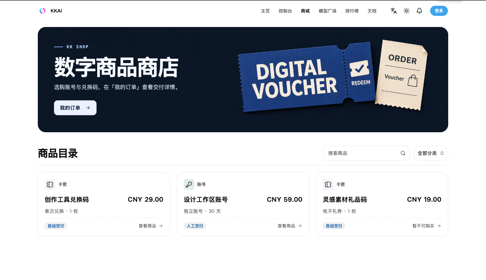

# KK 商城首页开发与验收

2026-11-19 定稿，适用于 `web/default` 的平台商城首页 `/shop`（PAGE-01）。买家在首屏能看懂这里卖账号和兑换码，在目录里比较价格与交付方式，也能从「我的订单」找回已购商品。商品详情、结账与订单沿用[商城前端开发规格](./kk-shop-frontend-development.md)。

## 定稿对照图



| 目录状态 | 桌面 1440 × 830 | 手机 | 首屏对照重点 |
| --- | --- | --- | --- |
| 三件已上架商品，其中一件售罄 | [浅色](./kk-shop-screenshots/storefront-v3/shop-light-stock.png) · [深色](./kk-shop-screenshots/storefront-v3/shop-dark-stock.png) | [浅色 390 × 844](./kk-shop-screenshots/storefront-v3/shop-mobile-stock.png) | 兑换券与回执可辨，搜索和分类可用，第一排可读到商品名、币种、价格与交付方式 |
| 空货架，同时暂停新订单 | [深色](./kk-shop-screenshots/storefront-v3/shop-dark-empty.png) | [深色 390 × 800](./kk-shop-screenshots/storefront-v3/shop-mobile-empty.png) | 「我的订单」可用，目录标题旁或下方有暂停提示，货架只展示一张空态卡 |

这五张图来自本地浏览器的简体中文访客页面。图中的名称、价格和库存只用于复现。320px 有窄屏行为检查记录，视觉基准以表中五张原图为准。

## 布局、配色与切图

以下尺寸按浏览器 100% 缩放、根字号 16px 计算。坐标指视口左上角起算的 CSS 像素。内容变长时让文字换行和卡片增高。

| 区域 | 桌面规则 | 窄屏规则 |
| --- | --- | --- |
| 页面画布 | 复用公共页头与 `main`。首页外层居中，最大宽 `76rem`。1440px 定稿中主视觉从 `(112, 80)` 开始，宽 1216px、高 312px | 390px 时左右各留 16px。主视觉从 `(16, 80)` 开始，宽 358px，中文定稿约高 357px |
| 主视觉 | 最小高度 `clamp(16.5rem, 22vw, 19.5rem)`，圆角 24px。文字区宽 48%，左留白 `clamp(1.75rem, 3.5vw, 3rem)`。图铺满容器，`object-fit: cover`，向右居中对齐 | ≤720px 时圆角 16px。先显示标识、标题、说明和「我的订单」，下接 `5:2` 图带。图片宽为图带的 180%，右侧固定，上缘 18% 渐显，使票券和回执同时入画 |
| 文字与按钮 | `KK SHOP` 用 12px 等宽字。标题 `clamp(2.5rem, 4.5vw, 4rem)`、字重 650、行高 1.12。订单按钮最小高 44px | ≤720px 时标题为 `clamp(2rem, 8.5vw, 2.8rem)`。说明可换行，按钮仍在图带上方 |
| 目录工具栏 | 与主视觉间距 `clamp(1.75rem, 3vw, 2.5rem)`，定稿中为 40px。标题在左，搜索和分类在右。下方有 1px 分隔线，到第一排商品间距 20px | ≤720px 时控件移到标题下方。搜索和分类共享一行，空间不足时换行 |
| 商品网格 | >900px 为三列，列间距 20px，卡片圆角 16px。1440px 下每列宽 392px，第一排约从 `y=511` 开始 | 360–900px 为两列，≤359px 为一列。≤540px 时间距为 `0.7rem`，卡片内边距从 `1.2rem` 减为 `0.8rem` |
| 空货架 | 一张通栏卡，最小高 192px。购物袋图标和说明作为一组居中 | ≤720px 时最小高 144px，图标缩为 52px，图文从左侧排起 |

主视觉使用同一张 [兑换凭证与订单回执 WebP](../../web/default/src/assets/shop/storefront-vouchers.webp)（1920 × 704，47,308 字节）。两种主题都保留蓝色票券和米白回执。底色 `#0b1625`，标题 `#f8faff`，说明 `#c1ccdc`，按钮为浅底 `#ebf1ff` 配深字 `#12223e`。标题、说明和按钮由 HTML 绘制，可翻译、可选择。图片声明固有宽高、`alt=""` 和 `fetchPriority="high"`。

货架跟随主站主题。正文、卡面、边线与次要文字分别使用 `--foreground`、`--card`、`--border`、`--muted-foreground`。卡密用票券图标，账号用钥匙图标，两者都配有文字标签。间距和断点维护在[商城样式](../../web/default/src/styles/shop.css)。

## 组件与数据

| 责任 | 实现约定 | 代码入口 |
| --- | --- | --- |
| 路由与页面框架 | 平台站点 `tenant_id === 0` 可进入商城。目录页用 `shop shop-storefront`，由主视觉承载订单入口。商品详情与订单子页由父布局提供商城子导航 | [商城布局](../../web/default/src/routes/shop/route.tsx) · [目录路由](../../web/default/src/routes/shop/index.tsx) |
| 目录与操作 | `CatalogPage` 从路由读取 `q`、`category_id`、`page`。提交搜索时去首尾空格，最多 100 字符。切分类时提交当前输入并回第一页。翻页保留筛选，浏览器后退时输入框与 URL 对齐 | [目录和商品卡](../../web/default/src/features/shop/pages/catalog.tsx) |
| 公开数据 | 并行读取 `GET /api/shop/products`、`GET /api/shop/categories` 和 `GET /api/shop/config`。商品以服务端返回的顺序展示。复用 `useShopQuery`、`shopRequest` 和 Zod 校验，公开缓存按站点和请求路径区分 | [查询](../../web/default/src/features/shop/hooks/use-shop.ts) · [请求](../../web/default/src/features/shop/api.ts) · [数据结构](../../web/default/src/features/shop/schemas.ts) |
| 商品卡 | 整卡为一个指向 `/shop/products/$productId` 的链接。`MoneyText` 按 `amount_minor`（字符串）、`currency`、`exponent` 显示金额。规格优先，缺省用摘要，最多两行。底行列交付方式与可用性，售罄商品也能进详情 | [商品卡](../../web/default/src/features/shop/pages/catalog.tsx) · [金额与分页](../../web/default/src/features/shop/components/common.tsx) |
| 商品封面 | `productImage(cover.url)` 解析成功才渲染封面，区域宽高比 1.85，`object-fit: contain`，图片 `loading="lazy"`。没有可用引用时收起图区，展示紧凑的类型标记。未知类型显示「虚拟商品」 | [封面解析](../../web/default/src/features/shop/assets.ts) · [同源图片校验](../../web/default/src/features/shop/lib.ts) |
| 订单与关于 | 「我的订单」指向 `/shop/orders?page=1`，访客登录后回到该地址。公共导航的「关于」在平台站点、导航模块启用、`/api/about` 返回去空格后非空内容时展示。后台保存 `About` 后使共享查询失效 | [买家路由](../../web/default/src/routes/shop/_buyer/route.tsx) · [公共导航](../../web/default/src/hooks/use-top-nav-links.ts) · [设置保存](../../web/default/src/features/system-settings/hooks/use-update-option.ts) |

## 状态与交互验收

| 给定状态 | 买家应看到或能完成的操作 |
| --- | --- |
| 商品请求首次加载 / 失败 | 加载时目录显示骨架。商品读取失败显示可重试错误，保留主视觉和订单入口。分类或配置单独出错时仍展示已取得的商品。点击重试重新读取三项公开数据 |
| 首页有商品 | 显示搜索，有分类数据时显示分类选择。有 `delivery_type` 才显示交付标签。`availability === 'available'` 显示「查看商品」，其余状态显示「暂不可购买」。当前页大于 1 或总数超过每页数量时显示分页 |
| 首页无筛选，`items=[]` 且 `total=0` | 显示「还没有商品」及上架后的说明。搜索、分类和分页收起，无虚构商品，也无需买家清除任何条件 |
| 第一页筛选无结果 | 保留搜索条件和筛选工具，显示无匹配提示。「清除筛选器」同时清空关键词和分类并回第一页 |
| 第 2 页及以后返回空列表 | 优先显示「这一页没有商品」。返回第一页保留原关键词和分类，用户可继续浏览 |
| `new_orders_enabled === false` | 在目录标题附近提示「新订单已暂停，已有订单仍可查看。」这一条件独立于货架是否有商品，订单入口始终可用 |

页面的阅读顺序为主标题 `h1`、目录 `h2`、商品或空态 `h3`。搜索框、搜索按钮和原生分类选择有可访问名称。商品卡与订单入口支持键盘聚焦，暂停提示使用 `role="status"`。沿用站点语言包与字体，服务端商品名称按原文显示。减少动态效果时取消卡片悬停位移。

## 本地复现与复核

1. 在已配置本地 API 的平台开发站点，从 `web/default` 执行 `bun run dev`，打开开发服务的 `/shop?page=1`。使用简体中文、访客身份、100% 缩放，回到页首。为复现图中的页头，使用站名 KKAI 和空的「关于」内容。
2. 在浏览器开发者工具 Network 中为三个 GET 请求启用本地响应覆盖，使用下表对应的完整 `success/data` 对象。覆写实际请求地址，包括 `products?page=1` 的查询参数。保留 HTTP 200 和 JSON 响应类型，再刷新页面。样例只放在文档目录。[只读响应样例](./kk-shop-screenshots/storefront-v3/catalog-fixture.json)

   | 复现场景 | `/api/shop/products?page=1` | `/api/shop/categories` | `/api/shop/config` |
   | --- | --- | --- | --- |
   | 已上架 | `products.stock` | `categories` | `config.open` |
   | 空货架并暂停接单 | `products.empty` | `categories` | `config.paused` |

3. 按定稿表切换主题与 CSS 视口，等待商品和首屏图载入后截取可视区域。在同尺寸原图上叠放对比，先对齐主视觉四边，再核对文字起点、票券与回执的轮廓、首排商品边线。390px 下两件商品并排，金额可以移到名称下一行。320px 下商品单列，键盘仍能到达搜索、分类、商品与订单。
4. 交互复核时，用有相应查询结果的本地接口或按查询参数切换覆盖。分别检查搜索无结果后清除、越界页返回、暂停时打开订单。用本地已有的售罄商品检查详情入口。再用长商品名、200% 缩放和键盘 Tab 抽查金额换行与焦点边界，用 `document.documentElement.scrollWidth === document.documentElement.clientWidth` 辅助检查横向溢出。

行为改动时在 `web/default` 运行对应的定向用例。目录测试保护空货架与筛选恢复，导航测试覆盖「关于」的四种组合。[目录用例](../../web/default/src/features/shop/pages/catalog.test.tsx) · [公共导航用例](../../web/default/src/hooks/__tests__/use-top-nav-links.test.tsx)

```sh
bun run test src/features/shop/pages/catalog.test.tsx src/hooks/__tests__/use-top-nav-links.test.tsx
```

2026-11-19 本地实施记录为 6 项定向用例通过，目录页使用的 35 个文案键在 7 个语言包中均有值。浏览器已检查 1440、390、320px 宽度，以及搜索、分类、分页恢复、详情入口、订单登录回跳和「关于」显隐。五张定稿图与这组本地状态配套，验收范围为商城首页与导航。

<details>
<summary>定稿文件的校验命令</summary>

在仓库根目录检查文档差异，并与交付的 PNG 原件比较。`approved_shots` 指向原图目录。

```sh
git diff --check -- docs/kkai
diff -rq -x shop-checks.md -x catalog-fixture.json "$approved_shots" docs/kkai/kk-shop-screenshots/storefront-v3
file docs/kkai/kk-shop-screenshots/storefront-v3/*.png
```

检查本页引用和五个规格入口。

```sh
python3 - <<'PY'
from pathlib import Path
from re import findall

base = Path('docs/kkai')
guide = base / 'kk-shop-storefront-development.md'
references = set(findall(r'\]\(([^)]+)\)', guide.read_text()))
for reference in references:
    assert (base / reference).is_file(), reference
for section in ('art-direction', 'development', 'frontend-development', 'review', 'ui-spec'):
    entry = base / f'kk-shop-{section}.md'
    assert f'(./{guide.name})' in entry.read_text(), entry
print(f'{len(references)} references and 5 entry points resolve.')
PY
```

在 `web/default` 用应用的 schema 校验样例响应。

```sh
bun - <<'JS'
import { categorySchema, configSchema, pageSchema, productSchema } from './src/features/shop/schemas.ts'
import fixture from '../../docs/kkai/kk-shop-screenshots/storefront-v3/catalog-fixture.json'
import { z } from 'zod'
const envelopes = [
  [pageSchema(productSchema), fixture.products.stock],
  [pageSchema(productSchema), fixture.products.empty],
  [categorySchema.array(), fixture.categories],
  [configSchema, fixture.config.open],
  [configSchema, fixture.config.paused],
]
for (const [schema, envelope] of envelopes) {
  z.object({ success: z.literal(true), data: schema }).parse(envelope)
}
console.log(`All ${envelopes.length} storefront fixture responses match the application schemas.`)
JS
```

</details>
