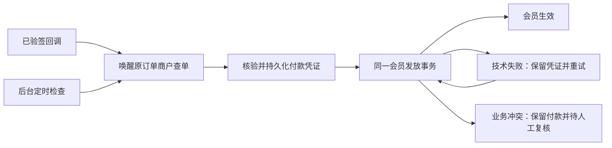

# 会员支付可靠性优化方案（2026-11-02）

## 决策

优先实施“主动认证查单 → 付款凭证独立持久化 → 幂等发放 → 故障重试”，
并行规划由我们控制的专用回调入口。会员到账不能依赖一次公网通知，也不能依赖用户返回页面。
复用现有任务调度、数据库、支付查询与加密能力，不增加消息队列或独立支付服务。

本文记录方案及本地实现；未执行生产数据库迁移、DNS/Edge 变更或应用部署。Zpay 无法提供更多通知诊断，
不再把获得其日志作为修复前提。历史事实见 [事故记录](membership-payment-incident-20261102.md)。
已补发的第 9、10 单作为幂等验收案例，不再次增加权益。

## 三个独立评审角色

| 角色 | 重点 | 共同决策中的贡献 |
| --- | --- | --- |
| 支付可靠性架构 | 丢回调后的自动恢复、任务领取、商户配置冻结 | 查单必须独立运行；每单退避和租约必须持久化 |
| 账务一致性与安全 | 重复发放、升级并发、凭证冲突、时间语义 | 先保存付款事实，再发放；唯一约束、账户版本和金额核验不能放宽 |
| 网络运维与可观测性 | 回调入口、CDN 拦截、故障定位、告警 | 专用通知入口与页面返回地址分离；记录入口到权益生效的完整状态 |

## 已确认的问题与尚未证明的原因

1. 会员订单没有认证查单补偿，页面轮询只读本地数据库。回调丢失会持续等待。
2. 保存会员收款凭证和发放权益处于同一事务；意外数据库错误会将两者一起回滚。
   原有“相同凭证已经存在便直接返回”的逻辑也不能直接用于独立发放重试。
3. 当前把处理时间写为付款时间，并用处理时间判断是否超过订单期限。
   因此，期限内付款、稍后才发现的订单也可能进入异常状态。
4. 回调拒绝缺少具体原因日志；全局回调地址同时承担机器通知和部分浏览器返回页面。

前一轮样本中，最后一笔回调来源的钱包收据之后，77 笔钱包收据均来自商户查单。
这支持尽快给会员补偿能力，但收据来源只表示首次持久化证据，不能证明上游从未重试。
Python UA 的 403/1010 以及 DNS 变更时间也是线索，不能当作真实 Zpay 通知失败的直接证据。
本方案不声称已经定位通知丢失的具体环节，也不重新声明当前生产版本或健康状态。

## P0：形成不依赖回调的到账闭环

### 主动查单

- 在现有 `system_tasks` 注册会员查单任务与会员收款凭证重试任务，仅允许 writer 后台执行。
  页面关闭、用户离开、任务进程重启，都不能影响恢复。
- 建议调度每 15 秒唤醒，新订单约 30 秒后首次检查；未付款或暂时失败逐步退避到 5 分钟。
  这些是初始设计值，启用前按商户查询限额及订单量调整，不能视作已经测得的服务能力。
- 每单持久化下一次检查时间、尝试次数、领取令牌与租约；结果写回必须校验领取令牌。
  `system_tasks` 的任务租约不能代替订单排程，任务历史可清理，也不能保存商户密钥。
- 单次网络请求有超时，批次有时间和数量上限。钱包与会员共用同一商户查询预算，避免竞争限额。
  外部请求在数据库事务之外执行；租约丢失后旧执行者不能覆盖新结果。
- 本地过期或关闭不等于未付款。待查范围包含有未清偿可能的到期订单，超过密集重试预算后
  转低频检查或人工待办；查无单、网络失败、预算耗尽都不能被写成“确认未付款”。
- 对原商户、原订单号、成功状态、支付流水、金额、币种进行严格核验。使用 HTTPS、禁止跳转、
  限制响应大小，金额按分解析；拒绝歧义 JSON、重复关键字段、畸形金额和明确退款信号。
  币种缺省只能按该已冻结通道的明确 CNY 合约解释。查询接口不提供完整退款账本，不能据此
  宣称已排除一切线下退款；保留现有财务复核机制。
- 只抽取已有易支付查询中可共用的传输和证据校验；会员调用会员发放逻辑，不构造虚假充值单，
  不合成签名回调，不绕过原有支付验证。

### 收款凭证与发放分离

- 事务一可靠保存商户认证查询后的付款事实；事务二更新会员账户、订单、发放结果及相关财务关联。
  验签回调只保存通知时间并唤醒查询，不能直接生成付款凭证或发放会员；持久化失败则返回失败供上游重试。
  持久化成功后的技术发放失败由本站恢复，业务异常也必须有可查询、可审计的待办。
- 同一流水、同一订单、相同事实的重复请求可继续未完成发放；已成功的返回原结果。
  不能保留目前“凭证存在便跳过一切”的分支。
- 一笔订单只能发放一次，同一付款流水不能绑定两个订单；同单额外付款、流水事实变化、
  金额或商户不匹配必须进入冲突处理，不增加权益。
- 保留既有用户→会员状态→订单→账户的锁顺序及数据库唯一约束；回调、查单和管理员重试
  竞争时由事务裁决，不能只靠进程锁或调度器保证。
- 已确认付款但未完成发放时，阻止同一用户创建会冲突的新会员购买/升级；不能把这类订单
  当成普通超时未付单清理。对并发创建的后续订单仍在发放事务内重新检查。

### 时间、会员升级与人工处理

- 分别记录支付方付款时间、本站核验时间和权益实际生效时间。支付方时间按明确时区解析，
  检查格式和合理范围；新增 `provider_paid_at` 保存可信付款时间，保留原 `paid_at` 的处理时间
  语义以兼容既有调用，不能反向把历史 `paid_at` 当作真实付款证据。
- 可信证据证明期限内付款，且只因系统超时关闭、购买/升级条件仍成立，可以自动补发。
  显式取消、人工处理、真实逾期、时间未知或存在冲突的订单进入复核，不能一律重新打开。
- 及时收到的正常回调仍按原有有效订单规则处理；延迟恢复需要付款时间却缺少证据时先查单，
  仍无法确认才待人工处理，不要求服务商回调增加其并不支持的字段。
- 升级必须仍是原账户、原修订版本，保留已消费和预留额度；存在并发升级、旧会员已结束或
  其他权益冲突时停止自动发放。支付方式别名要按核实的通道协议处理，不全局关闭方式校验。
- 建议补发后按实际生效时间开始完整购买时长，保留现有升级计时规则；用户付款时间仅用于
  支付事实和期限判断。补偿时长政策不得通过重写付款时间实现。
- 管理员“查单并重试”复用同一核验与发放入口，记录操作人、操作 ID、原因、证据来源和结果。
  不以手写 SQL、改金额、延长订单期限或伪造管理员身份作为常规客服流程。

### 最小数据扩展

| 数据 | 建议落点 | 要求 |
| --- | --- | --- |
| 原网关、商户身份、凭据版本、加密凭据 | `kkai_membership_payment_checks` | 建单时与订单原子保存；密钥加密并绑定原用户、订单及商户 |
| 每单检查进度、领取与退避 | `kkai_membership_payment_checks` | 持久化、索引、有界扫描，不放进任务历史 |
| 证据来源、原商户、支付方时间、核验时间 | `kkai_membership_payment_evidence` | 只接受服务端认证查单事实，不输出密钥、签名或原始响应 |
| 发放进度、重试时间、错误类别、完成时间 | `kkai_membership_payment_evidence` 及既有订单关联 | 技术重试与业务待审分开，支持崩溃恢复 |

完整首期使用显式 v20 schema 扩展，不能零迁移。既有订单 `Terms` 不承载新密钥，
订单 API 使用显式 DTO，不向客户暴露快照。
沿用已有 AES-GCM 能力并绑定会员订单作用域，保留旧密钥读取能力；不能使用会随重启变化的密钥。
查询和验签都要使用原订单的商户配置，当前全局配置只能服务新订单。

历史无快照订单仅在保存的商户、支付地址及签名可以与已知原凭据匹配时进入受限补查，
无法证明则列出待复核。保留原回执键及发票关联；首期增加商户证据而不直接重写历史唯一键。
若未来扩大到多商户且流水号只在商户内唯一，再单独设计兼容的唯一键升级。

### 防止盗用凭证和重复领取的硬约束

这里的付款凭证是本站通过验签或商户认证查询取得的服务端事实。用户提交的截图、流水号、
浏览器返回参数及支付成功声明都不能直接进入可发放凭证表；建单时的已签名支付表单也不证明已付款。

- **权益绑定原订单所有者。** 用户在建单时来自登录身份，发放时只读取数据库中的订单归属、
  冻结套餐和价格，不接受请求传入的受益用户、金额、档位或时长。拿到别人的订单号不能改变归属。
- **自助检查不接收付款证据。** 接口必须登录并校验订单属于当前用户；缺失用户 ID 必须拒绝，
  不能落入内部 `userID=0` 的全局查询模式。只允许触发本单服务端查单，不接收客户端的
  `paid`、流水绑定、网关地址或商户配置；按用户、订单及全局查询预算限频，并采用现有 CSRF 防护。
- **重复只能返回原结果。** 同一流水跨账号、跨订单不得授予权益；重复回调、按钮连点、
  后台任务并发与崩溃恢复都必须受数据库唯一约束和订单发放终态保护，不能刷新会员有效期。
- **已保存不等于可发放。** 保存独立的核验结果和阻断原因。重试只选核验通过且发生技术失败
  的记录；金额/商户冲突、退款、待审核及人工已驳回记录不能被定时器自动转成成功。
  每次发放仍检查原订单身份、金额及账户资格；负查询和后续重放不能抹掉人工裁决。
- **密钥及查询目标不能由客户控制。** 商户密钥仅在服务端加密保存、使用时解密，禁止进入
  前端、任务 API、URL 日志或原始错误输出。查单只使用受信配置中冻结的 HTTPS 网关，
  保留证书校验并禁止重定向，避免把带密钥的查询发送到攻击者地址。

以上约束防止订单号、支付截图或旧通知被挪用；不能据此承诺商户密钥、管理员权限或数据库
已经失陷时仍绝对安全。**原商户认证查单是唯一可自动发放的易支付付款证据来源，
不是可选模式。**回调只作为查单触发线索，查询失败时保持等待。
未核实的通知线索不能占用最终回执唯一键、标记已付款或触发财务冲突锁，以免抢占真实付款；
如提前确认接收通知，须先原子保存线索及待核验任务。重复线索按订单合并并限频。
其代价是商户查单不可用时暂缓新会员发放，不能静默退回只凭回调发放。

## P1：建立可控的专用通知入口

- 使用我们自主控制、稳定解析的支付子域，减少第三方 SaaS/优选入口依赖。
  若使用 Cloudflare，在我们可管理的 Zone 内对准确的机器通知路径免除浏览器挑战；
  保留 HTTPS、验签、商户/金额核验、请求大小限制及适合支付重试的限流。
- Edge 只转发审查通过的通知路径到固定平台 Host，其余返回 404，防止误入租户路由；
  新入口不能同时获得后台或模型转发能力，也不能削弱主站源站保护。
- 先拆分“机器通知基址”和“浏览器返回基址”。不能直接修改全局 `CustomCallbackAddress`：
  它还影响旧订阅返回页面、商城订单返回页面以及钱包/Waffo 通知。
- 本地实现已有仅会员使用的 `KKAI_MEMBERSHIP_NOTIFY_ADDRESS` 可选 HTTPS origin；未配置时沿用旧基址。
  尚未建设或切换专用 DNS/Edge。新订单冻结生成的通知 URL；在途订单保留原表单和旧入口。
  退役依据未结订单和服务商重试责任窗口，不以本地订单到期时间为唯一条件。
- 查单补偿先于入口切换上线；入口修复不能替代补偿，也不以更换整个主站 DNS 作为首选措施。

## P0 同步落实：诊断与客户处理

每个订单能回答四个问题：通知是否到达、核验是否通过、付款是否保存、权益是否生效。
回调、主动查询、人工复核记录各自来源及关联 ID，历史回调不能被后来的查询覆盖。

| 监控项 | 建议初始动作 |
| --- | --- |
| 已核验付款但 2 分钟未发放 | 进入运维待办；业务待审立即显示具体原因 |
| 对账任务持续 3 个调度周期未成功运行 | 告警并检查 writer、租约及数据库 |
| 最老待查订单年龄、查询失败率 | 按持续时间和样本量告警，避免零交易时误报 |
| 有成功支付但回调长期为零 | 提示回调入口异常，不能被“总体到账正常”掩盖 |
| GET/POST、多种 UA 的固定无效签名探针 | 预期应用 `200 fail`；连续失败才告警 |

探针记录状态、耗时、CF-Ray 和请求关联，不记录完整查询串、表单或密钥。
无效签名只能证明公网入口可达，不能证明 Zpay 真实通知链路成功。
告警先接入已有运维能力，通知渠道另按实际配置接入，本文不发送外部消息或建立定时任务。

用户页面继续轮询本站状态；可增加限频的“已付款，检查到账”，由服务端认证查单。
它只是加速入口，后台任务负责兜底。界面明确区分待付款、已确认付款正在处理、需人工核对、
已经生效；不让用户反复支付。新增页面文字实施时须遵循项目 i18n 规则。

## 实施与放量顺序

1. **代码和数据方案准备（本地已完成）**：v20 双旁路表、回调唤醒、认证查单、独立证据与幂等发放、
   自助/管理员检查、后台任务及定向测试。生产数据库迁移需要独立授权和已安装的版本专属控制器。
2. **识别验证**：迁移完成后，启用 `KKAI_MEMBERSHIP_PAYMENT_RECONCILE_ENABLED=true`，
   保持 `KKAI_MEMBERSHIP_PAYMENT_FULFILL_ENABLED=false`，比较查单结果与既有订单，记录“拟发放/待复核及原因”。
   不制造已付款假回调；先确认历史凭据归属和新订单快照正确。
3. **启用首期闭环**：再启用 `KKAI_MEMBERSHIP_PAYMENT_FULFILL_ENABLED=true`，按明确订单范围放量。
   两个开关默认均为 false，核验与自动发放独立开关，
   暂停发放仍能保存有效付款证据并展示待办。第 9、10 单重复处理应没有权益变化。
4. **切换专用入口**：完成 Host、路径、返回页面和旧订单兼容验收后仅用于新订单。
5. **扩展历史清算与运营**：低频检查、待审处理和用户自助检查，按积压和查询预算调整参数。

数据库扩展须兼容 SQLite、MySQL 5.7.8+、PostgreSQL 9.6+，使用项目显式 schema 合约及
精确运行时能力检查；现有“表存在”探测不足以证明新增字段可用。发布遵循 NewAPI 手动交付
runbook；业务补单与应用发布分开。回滚不能删除已收付款事实，也不能让旧程序误认新回执已发放。
启用新凭证状态后，旧版本只有经过兼容验证才能作为回滚目标，否则先准备兼容回滚版本。

## 验收标准

| 场景 | 必须达到的结果 |
| --- | --- |
| 完全没有回调，商户查询正常 | 符合条件的已付款订单由后台自动生效，页面无需保持打开 |
| 回调、查询、管理员重试并发 | 同一付款只发一次，额度和会员期限不被重复增加 |
| 凭证保存后崩溃、发放事务失败 | 凭证仍存在；重启后恢复，不重新要求用户付款 |
| 同一流水用于两个订单或同单多次付款 | 拒绝重复权益，保留财务冲突证据 |
| 用户 B 提交用户 A 的订单号/流水号或修改受益账号 | 拒绝越权；B 的权益不增加，不返回 A 的支付详情 |
| 截图、伪造成功参数、未支付的已签名 checkout | 不生成可发放凭证，不授予会员 |
| 待审核、核验失败或人工已驳回记录进入重试扫描 | 不自动发放、不清除阻断原因 |
| 强验证模式下回调通过验签但商户查单未确认付款 | 保持待核验，不授予会员，不自动降级验证 |
| 期限内付款但迟到发现 | 有可信付款时间且业务条件仍成立时自动恢复 |
| 实际逾期、付款时间不明、主动取消 | 按规则待复核，不伪造付款时间或放宽条件 |
| 升级同时存在消费/预留及版本变化 | 已用、预留正确；版本冲突不强制升级 |
| 错误商户、金额、币种、退款信号或畸形响应 | 不发放，输出可诊断的脱敏原因 |
| 凭据轮换、任务重启、租约过期 | 老单使用原配置，失效执行者不能覆盖新结果 |
| 已人工补发的第 9、10 单再次收到相同证据 | 权益、额度、期限保持不变 |
| Stripe/其他会员支付路径 | 共享发放逻辑改造后保持原验证与发放契约 |
| 新入口上线及原入口退役准备 | 新真实订单验证完整回调；旧在途订单仍可通知和查补 |

建议目标是在正常负载、商户查询可用且预算允许时，缺失回调的付款多数在 1–2 分钟内恢复。
退避后的长时间未付单、上游不可用、业务冲突不纳入此承诺，需分别观察并告警。
目标须通过受控验收测量，不能以设计参数冒充现网 SLA。
真实新订单支付验收需要具体授权；无回调、故障和竞争场景在隔离环境验证，不在生产制造故障。

## 代码落点与本次验证范围

- `controller/membership_payment.go`、`controller/membership_payment_check.go`：冻结原商户、
  验签后只唤醒查单、自助与管理员查单入口、脱敏状态。
- `model/membership_order.go`、`model/membership_payment.go`：旁路表、领取/重试、时间语义及幂等发放。
- `service/membership_payment_*.go`：原商户查单、历史凭据导入及系统任务 handler。
- `service/epay_query_budget.go`：钱包、发票、会员共用商户查单预算。
- `service/epay.go`：会员专用通知 origin，浏览器返回地址仍走原逻辑。
- `pkg/kkaimigrate/schema_membership_payment.go` 与 `cmd/kkai-migrate/membership_payment_migration.go`：
  显式 v20 结构和独立受控迁移入口。基础设施控制器在兄弟仓库本地实现，尚未安装。

本地已完成代码实现、定向测试及 SQLite/MySQL/PostgreSQL 的 v20 结构与付款发放并发验收。
生产未部署，v20 未迁移，通知子域未切换；全量测试和生产真实支付验收均未运行。
详细结构、显式迁移与回滚条件见 [v20 迁移契约](membership-payment-schema-v20.md)。
