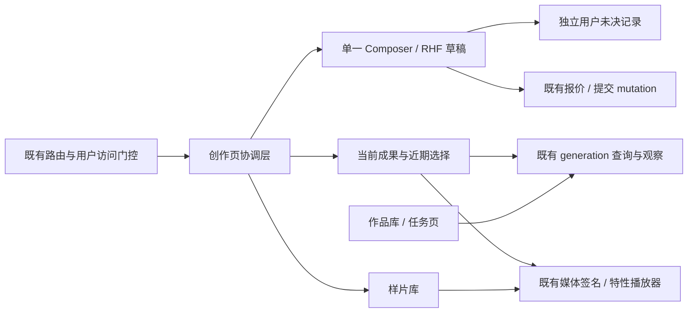

# 视频工作室重构 · 开发总纲

版本：1.0 · 2026-10-28。状态：开发方案与代码核对稿；未实施业务代码、未部署。代码核对基于本地 `HEAD 1ead6eb1fccb` 及当前工作区，工作区还存在其他任务改动，不代表不可变发布版本。

## 1. 实施目标与依据

将现有视频工作室改为“精致创作台”：同页编辑、提交、查看当前成果；以暗色 V2 的层次、组件、插画使用及功能性动效作为本轮视觉基线，同时保留系统浅色主题。业务仍使用现有模型规格、上传、报价、提交、作品及签名媒体链路。

本轮交付开发文档，范围包括代码复用决策、状态与接口契约、文件级开发任务、验收门槛和独立技术审查。它不是生产实现或上线验收，也不把继续编写文档解释为用户已批准全部设计细节。

| 依据 | 负责的问题 | 冲突处理 |
| --- | --- | --- |
| [产品文档](prd.md) | VS-01～VS-20、页面职责、付费与恢复语义 | 行为按 PRD；新增范围先修订需求 |
| [视觉与交互规范 v1.2](ui-spec.md) | 最新暗色 V2 token、12px 卡片圆角、400px 编辑栏、动效及响应式 | 覆盖第一轮旧色值/尺寸；生产仍跟随应用主题 |
| [交互设计稿](design.html?theme=dark&scene=ready&page=create) | 构图、组件与关键状态的可视参考 | 演示状态、计时、假金额、样例视频控制不得复制为业务实现 |
| 当前源码及 [接口与状态契约](api-and-state-contract.md) | 已存在的能力、尚需补足的行为 | 不以设计稿推定接口存在；冲突在开发前显式解决 |

阅读顺序：本总纲 → [前端开发与复用方案](frontend-development.md) → [接口与状态契约](api-and-state-contract.md) → [质量与验收](quality-and-acceptance.md) → [技术审查记录](development-review.md)。

## 2. 技术结论

采用现有 React 19、TanStack Query/Router、RHF/Zod、Zustand、Base UI 和 Uppy，不更换技术栈，不引入新的播放器、动效或状态机依赖。CSS 负责布局和常规动效，原生视频控件负责基础播放可访问性。既有 `motion` 依赖仅在 CSS 确实不能表达局部交互时使用，不为这次改版扩大依赖。

基线是 **前端重构与安全补足**。现有后端接口可以支撑这版体验，但有明确上限：无法按未知操作身份精确查询最终受理结果；仅有 task_id 时采用现有 30 秒列表发现；没有证据的未决记录持续保留。不会为了界面完整而自动补发生成、推断退款或引入全站任务日志作为 Studio 历史源。

| 当前实现 | 目标实现 | 开发性质 |
| --- | --- | --- |
| 创作以样片墙为中心，窄屏使用编辑抽屉 | 单一编辑器在左/上，当前成果在右/下 | 布局与组件重组，上传实例不可因断点更换 |
| 成功回执跳作品库 | 保持 create 路由，保存目标 task，定位新任务 | 路由、选择与局部结果状态改造 |
| 提交防重以组件 ref/lock 为主 | POST 前持久化用户隔离的未决记录，恢复只读 | 本期新增安全行为，不是现有能力 |
| 作品库卡内播放，视频 `object-cover` | 主成果/详情完整 `contain`，列表封面才裁切 | 特性内共用播放器及只读详情内容 |
| 列表头轮询会合并新记录 | 更新已有记录状态；新记录提示后由用户接受置顶 | 显示顺序与服务端缓存分离，不另建轮询 |
| 私有 Studio 查询使用公共用户边界，签名查询另设 key，逐路径失败会丢失拒绝原因 | 签名媒体接入同一用户边界、传播取消信号并保留明确的授权拒绝证据 | 小范围共享修正，须覆盖图片工作室直接依赖 |
| 视觉/状态提示分散 | 作用域 token、分层表面、组件状态与减少动态效果 | 新增特性样式，保留全站基础组件约定 |

## 3. “视频作品”的复用裁决

实际核对 [视频作品目录](../../../web/default/src/features/usage-logs/video-works/) 后，保留其好的体验模式，同时避免把两种数据域混在一起。详细证据与组件映射见前端文档的复用矩阵。

| 复用等级 | 本次采用 | 原因与边界 |
| --- | --- | --- |
| 直接复用 | `Button`、`Dialog`/`AlertDialog`、`Tooltip`、`Skeleton`、剪贴板 hook、项目金额/日期工具 | 视频作品也依赖这些公共基础设施；按 Studio 文案和 44px 操作目标组合 |
| 特性内抽取 | Studio 主成果与作品详情共享播放器/状态/只读信息；create/library 共享目标发现逻辑 | 有真实的两个调用方；仍接收 `VideoGeneration` 或明确媒体 props |
| 行为参考 | 视频作品完整播放、局部加载失败、一次媒体恢复、任务号复制、状态插画、移动端信息顺序 | 按 Studio 媒体与状态契约实现；不能复制其全部错误/刷新处理 |
| 受控素材复用 | `src/assets/video-works/` 的空态/处理中插画可复用；新器材静物用于已设计的装饰位 | 保留视觉一致性和静态性质；首屏不把所有素材预载 |
| 不直接复用 | `VideoWorkPreview`、`VideoWorkDetails`、下载/artifacts/selected hooks、筛选/计费组件、整份 `video-works.css` | 绑定 `TaskLog`、管理员作用域、多产物、日志分页与独立媒体端点；不是通用 Studio 组件 |

特别禁止把 Studio generation 转成假的 `TaskLog` 来满足 props、把 `SUCCESS` 当作 `ready`、将全站四类状态筛选/统计搬进 Studio、为共享播放器引入收费或管理员上下文。`VideoWorkCopy` 虽然只接收 taskId，仍依赖日志页面样式和小号按钮；直接组合其公共底层能力即可，不必跨特性导入。

代码参考并非照抄：视频作品播放器的 key 包含媒体 URL，直接移植会在签名变化时重挂载；其列表遇 query error 时隐藏内容，也不符合本 PRD 的旧快照保留规则。两点均有针对性的验收要求。

## 4. 模块边界与状态所有权

| 所有者 | 保存什么 | 不保存什么 |
| --- | --- | --- |
| RHF + 既有 draft store | 当前输入、参数、素材引用与续传信息 | 当前作品详情、签名 URL、未决操作唯一副本 |
| 新增最小 pending store | 用户、操作身份、规范化指纹、时间、已知 task/generation 和证据状态 | 完整 POST、token 密钥、文件二进制、自动重放队列 |
| TanStack Query | 模型、报价、样片、服务端 generation 快照 | 用户主动选中项的权威值、表单值副本 |
| 页面协调层/受校验路由 | 当前目标、用户选择、显示顺序、活动媒体、确认弹层 | 第二套轮询器、第二份草稿、全局泛化工作室框架 |
| 媒体层 | 当前受权签名、播放/局部错误与一次恢复计数 | 持久化签名、从其他用户缓存复用 URL |

`task_id` 是字符串，generation `id` 是数字。明确目标优先于历史选择，后台刷新只更新状态。路由只保存定位标识，权限仍由服务器验证。用户切换时以身份边界重置私有视图，不能把查询 key 已含 userId 当作“缓存已经清理”的证明。

未决记录是多操作集合，不是一个会被下一次输入覆盖的布尔锁。每次付费点击先校验、规范化、检查等价未决记录，再持久化成功，最后 POST；任何无明确结果的网络路径保留待核实。完整状态机、错误证据表与指纹规范以接口文档为准。

## 5. 可独立审查的开发批次

批次是实现和审查单位，不要求新增 Git 分支/worktree，也不代表独立可发布。未完成安全批次前不得把新布局作为完整功能交付。文件名为计划，现有/新增以各分册标注为准。

| 批次 | 主责 / 协作 | 主要改动 | 进入条件 | 退出证据 |
| --- | --- | --- | --- | --- |
| P0 契约与基线 | 技术负责人、产品、UI | 固定本开发包、列明受影响文件、记录旧功能最小样例 | 已读 PRD/UI/源码；识别其他任务脏文件 | 现有与新增能力分清，风险无未处理 P0/P1 文档问题 |
| P1 提交与恢复 | 前端状态负责人、后端契约审查、QA | pending store、规范化指纹、receipt 运行时校验、POST 前持久化、异常归类、账号迟到响应门控 | 接口与状态契约评审完成 | 存储失败不发送、发出即刷新、2xx坏响应、改稿再改回、24h到期和账号切换的定向测试通过 |
| P2 创作台与路由 | 前端组件负责人、UI/交互 | 单编辑器、创作留页、create/library 目标 search 校验、选择/发现、模型/画幅/高级参数、费用独立区域 | P1可接入；保留原表单/上传协议 | sample/task旧链接不退化；桌面/手机切换不丢草稿和上传；历史异常不封锁表单 |
| P3 媒体与公共边界 | 前端媒体负责人、安全审查、QA | Studio播放器与详情、contain、签名续期/错误恢复、媒体互斥、共享签名缓存及路径拒绝证据修正 | 已明确媒体身份、source生命周期及直接调用方 | 播放与样片互斥；正常续签不跳回0；收到401/403/404等拒绝证据、删除/换账号后不展示旧媒体；图片工作室相关回归通过 |
| P4 作品库与任务页 | 前端数据负责人、产品、QA | 稳定展示顺序/新内容提示、日期分组、全部/ready、只读详情、删除与焦点、任务行 | 复用P2定位及P3媒体能力 | 新数据不抢选中/滚动位置，加载更多失败保留列表，删除迟到响应不复活记录，任务页不伪造统计 |
| P5 视觉与可访问性收口 | UI工程、视觉设计、无障碍、国际化 | token、素材、160–260ms动效、减少动态效果、七语言、触控与长文本 | 三页真实状态均已接入；不依赖演示脚本 | D01–D09与真实实现逐项核对，暗/浅+五宽度+键盘/软键盘/200%文字证据完整 |
| P6 集成审查 | 技术负责人、QA、产品、UI | 仅本任务 diff、受影响测试、风险关闭、实际开发状态记录 | P1–P5退出门槛通过 | 所有VS需求有验证记录，阻断缺陷为零；剩余限制和未执行检查显式列出 |

P2可提前做组件布局，P3/P4可在接口边界明确后并行；同一文件同时只由一个负责人编辑，集成前协调共享 `queries.ts`、composer、route和locale变更。UI角色在每批验收画面与交互，不把所有美术问题留到P5；P5是最终收口。

质量分级：单模块样式/组件通常 L1；跨页选择、路由和共享媒体调用契约至少 L2。P1 新增持久化与并发边界按 L3 审查；P3 涉及私有缓存、鉴权拒绝处理，也按 L3 安全门槛审查，并定向覆盖 L2 共享消费者范围。全局认证、依赖、数据库或发布机制如有变化另行评估。风险等级不自动授权全套检查；按质量分册选择必要验证并遵守审批规则。不能因为只有前端文件就把付费防重或媒体权限当作低风险。

## 6. 代码质量与合并门槛

1. 每个状态只能有一个权威来源；派生值在渲染时计算，不用 effect维护可计算副本。只在确实需要生命周期/外部同步时使用 effect，不以“文件超过200行”为由机械抽函数。
2. 请求解析处验证最小可信字段；TypeScript泛型不是运行时校验。没有证据的结果按unknown处理。禁止宽泛 `any`、双重断言绕过类型或用 `as TaskLog` 兼容错误数据域。
3. 保留已有模型规格/参数验证、false/0、上传续传与素材角色顺序。报价准备、失效和提交要绑定同一请求，不因UI重排改动计费公式或默认值。
4. 请求与缓存复用现有层；不要在组件中新增 `setInterval` 刷任务，不由主播放器和近期缩略图各开独立列表查询。签名取消信号必须传递到批请求及失败回退请求，取消不触发逐条回退。401认证失败整体传播，逐路径403/404保留拒绝证据供消费者清媒体；临时网络错误与撤权不能混为一谈。
5. 仅抽真实复用且不耦合数据域的组件；不为未来可能的图片/视频统一引擎建 adapter、registry、factory。视图层保持清晰显式的分支，错误语义不得被“通用状态组件”吞掉。
6. 新文本遵循项目 i18n skill；实际运行语言为七种，不能只补中文/英文。沿用现有旧键，不借本任务批量重命名所有翻译。
7. 测试保护用户行为与风险边界；不靠全量快照、覆盖率百分比、随机压力循环或任意 sleep 证明正确。新增安全逻辑必须有可失败的定向回归；纯视觉资产不加镜像实现的测试。
8. 每批对本任务文件做 scoped lint/格式检查及相应行为测试。全项目 `typecheck`/build/套件需遵守用户审批规则；没有文件级typecheck时如实保留缺口，不伪造定向类型检查。最终发布前仍须满足正式发布门槛。

每次审查必须回答：改了哪些行为、复用了什么、是否触及共享消费者、失败时能否重复扣费/丢草稿/泄露媒体、对应验证在哪里。代码审查、产品验收和视觉验收分别记录，不能互相替代。

## 7. 明确限制与后续项

| 项目 | 本期处理 | 升级条件 |
| --- | --- | --- |
| unknown精确对账 | 仅只读发现/已知generation查询；无证据持续待核实 | 若产品要求每次unknown都自动得到终态，单独设计用户隔离的只读操作查询API |
| 跨标签页竞争 | 可监听storage同步提示，但不宣称原子互斥；服务端现有幂等仍有效 | 若要求不同标签页同时点击同内容绝不生成两个操作，需另设计原子协调并验证浏览器能力/服务端语义 |
| 本地记录被手动清除/浏览器清理 | 不宣称持久化是永久存储或服务端幂等账本 | 跨设备可靠恢复需要服务端协议，不能靠延长localStorage TTL实现 |
| 删除终态 | 本期UI按ready/failed提供入口；后端当前没有终态校验 | 服务端强制终态限制属单独加固项，需要契约、并发和多数据库验证；本期不得宣传为已有保证 |
| 历史完整再生成 | 不提供；现generation不含完整参考素材输入 | 后端安全返回完整可恢复输入且产品确认后再设计 |
| 全历史搜索/状态计数 | 不新增；保留现有全部/ready游标分页 | 有支持分页前筛选/统计的明确接口后再加入 |

这些上限是设计边界，不是可以跳过的质量验证。若实施中发现要求只有新增后端能力才可满足，应暂停该项并先修订范围，不能伪装前端完成。

## 8. 交付、回退与发布边界

当前任务只写文档。未来开发只提交本任务文件，保留已有商城、迁移、路由、翻译等其他任务改动；不自动创建分支/worktree、不自动提交或部署。

基线完成后按前端发布范围处理；共享媒体修正仍是前端范围。若加入后端终态删除或精确对账接口则转后端/组合范围，重新核定验证与发布路径。实际发布必须读取维护中的 NewAPI 运行手册并从当时已安装能力与后端 manifest取证，本开发文档不预设生产槽位或发布格式。

回退应在本任务确定的代码/制品范围进行，不能 `reset` 或覆盖整个脏工作区。新pending记录需有schema版本；回退到不识别pending的旧前端可能允许用户重复提交，因此P1必须配套回退说明：先确认是否存在待核实记录，存在时保留能够识别并展示保护提示的安全版本，或修复前向恢复；不能将“回滚前端”写成无条件安全。真实发布仍以发布runbook的精确版本和验收为准。

本轮文档检查与独立审查结果见[技术审查记录](development-review.md)。未来业务测试、视觉实机检查、类型检查与发布验证均由实施阶段补充，不沿用设计原型的通过记录替代。
