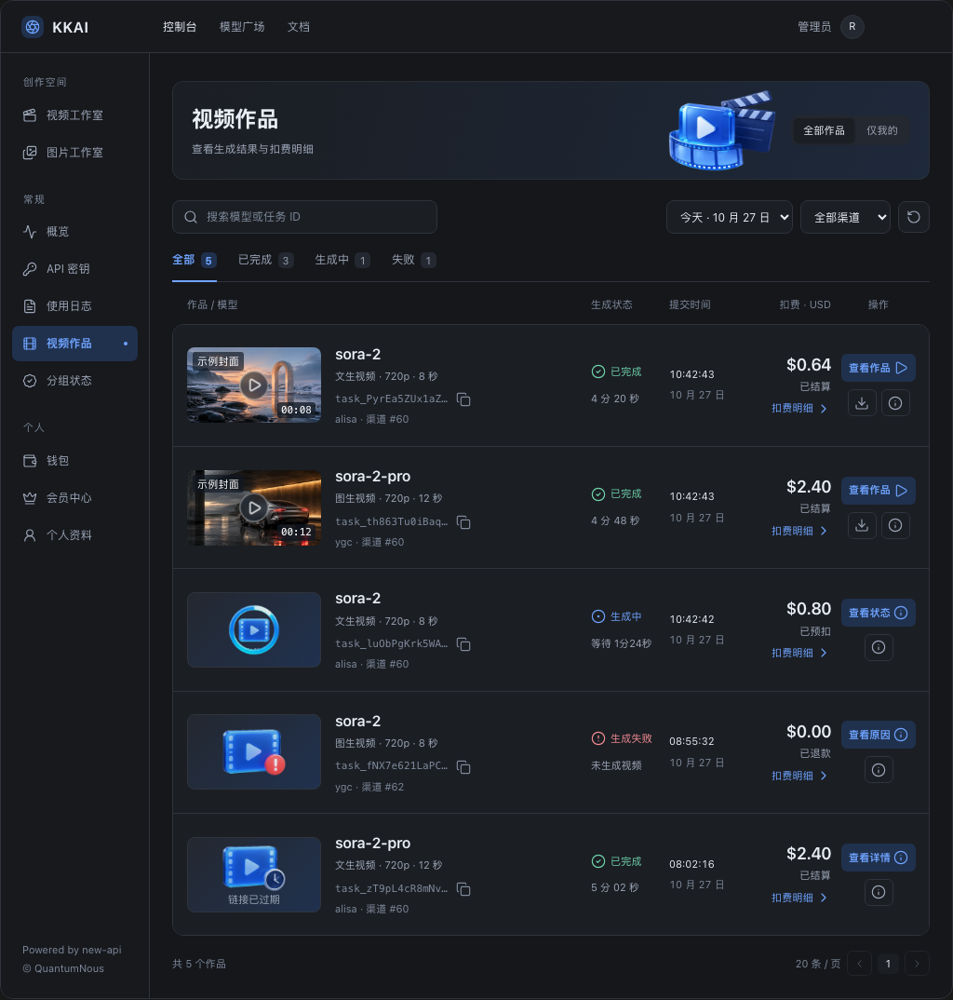

# 最终设计基准

本目录归档用户确认的完整稿，源文件为 `video-works-complete.html`。此前的简版/单插画版本已经被替代，不作为开发基准。

## 文件与优先级

| 文件 | 原始尺寸 | 用途 |
| --- | --- | --- |
| [prototype.fragment.html](prototype.fragment.html) | HTML fragment | 最终交互、排版与样式源，原文逐字节保存 |
| [desktop-dark.png](desktop-dark.png) | 1024×1074 | 桌面深色最终基准 |
| [desktop-light.png](desktop-light.png) | 1024×1074 | 桌面浅色最终基准 |
| [mobile.png](mobile.png) | 375×2429 | 手机全页最终基准 |
| [preview.png](preview.png) | 1024×1074 | 作品预览最终基准 |
| [empty.png](empty.png) | 1024×748 | 首次空态最终基准 |
| [retry.png](retry.png) | 1024×1074 | 暂时加载失败及重试最终基准 |
| [billing-reference.png](billing-reference.png) | 1024×850 | 早期同布局扣费抽屉的补充参考；不是最终版本截图，以最终 fragment 的抽屉和真实计费契约为准 |

fragment 面向原来的 Codex visualization 容器，含原型图标/控制面板协议与内嵌示例资源，**不是已实现的 React 页面，也不保证直接双击即可完整运行**。审阅可先看截图和源样式；正式实现不得复制其 DOM 操作、Tweak、`window.openai`、模拟下载或模拟播放器脚本。

原型外壳中的导航仅表达上下文，正式页面复用真实应用导航。原型的日期选项未做真实过滤，播放/下载是说明性模拟，账务和数量为静态样例。示例不作为后端能力或业务默认值。

## 视觉标尺

主要尺寸由 [前端方案](../frontend-implementation.md) 定义；以下是设计色值参考，左为浅色，右为深色。实现用项目主题体系下的局部语义变量，不向全局写死原型颜色；已有变量无法准确承载时只在作品区域补局部 token。

| 用途 | 浅色 | 深色 |
| --- | --- | --- |
| 内容背景 | `#f7f8fa` | `#15171b` |
| 面板 | `#ffffff` | `#1b1e23` |
| 中性次级背景 | `#f1f3f7` | `#242830` |
| 分隔/边框 | `#e5e8ee` | `#30343c` |
| 主文字 | `#202632` | `#e9edf5` |
| 次文字 | `#606c7e` | `#9ca6b7` |
| 弱提示 | `#778294` | `#7e899b` |
| 交互蓝 | `#2463db` | `#6fa4ff` |
| 主按钮填充 | `#2864db` | `#306cdb` |
| 蓝色浅底 | `#edf3ff` | `#20314e` |
| 成功 | `#19764f` | `#70d4ac` |
| 失败 | `#c13e4c` | `#f28b93` |

主内容边距约 24px，标题卡高约 104px，列表圆角 12px，桌面封面 144×81px。模型 16px/600、金额 18px/600；手机模型 17px、金额 21px。预览宽度上限 900px，右侧详情约 245px；扣费抽屉实现目标 380px，原型实测约 373px。完整布局、缩小规则和触达面积以前端方案为准。

设计的 11–12px 辅助字不能用于掩盖过长正文。实际字号、触达面积和对比度若需为可访问性调整，应记录对照依据；保留主次层级。原型部分小图标点击区不足 44px，正式触屏实现必须扩大点击区。

## 数据与视觉的差异处理

- 原型中的“已结算”“已退款”“链接已过期”是带特定事实前提的演示状态。缺少该事实时使用产品/后端约定的准确文案，保持同一布局。
- `expires_at` 若表示签名有效期，到期可以重新签发，不能据此把作品改成永久失效态。
- 真实视频封面优先；状态图、缺图占位、暂时错误的呈现分别验收。不能将两张演示封面替换到用户视频上。
- 宽高数字是设计目标；对比时使用同内容区宽度，不把截图拉伸。原生播放器 controls 与真实应用外壳允许有平台差异，内容层级和可用操作仍必须一致。

## 归档与复核

[manifest.json](manifest.json) 记录 20 个归档文件的源名、分类、字节数、像素尺寸及 SHA-256；[SHA256SUMS](SHA256SUMS) 可从 `docs/kkai/video-works/` 执行 `shasum -a 256 -c design/SHA256SUMS` 核对。素材的 PNG/WebP 与原型、截图均保持来源文件字节一致。

后续真正更改设计时保留变更说明并重新审查。不要为了让实现截图通过而直接覆盖本基准。
