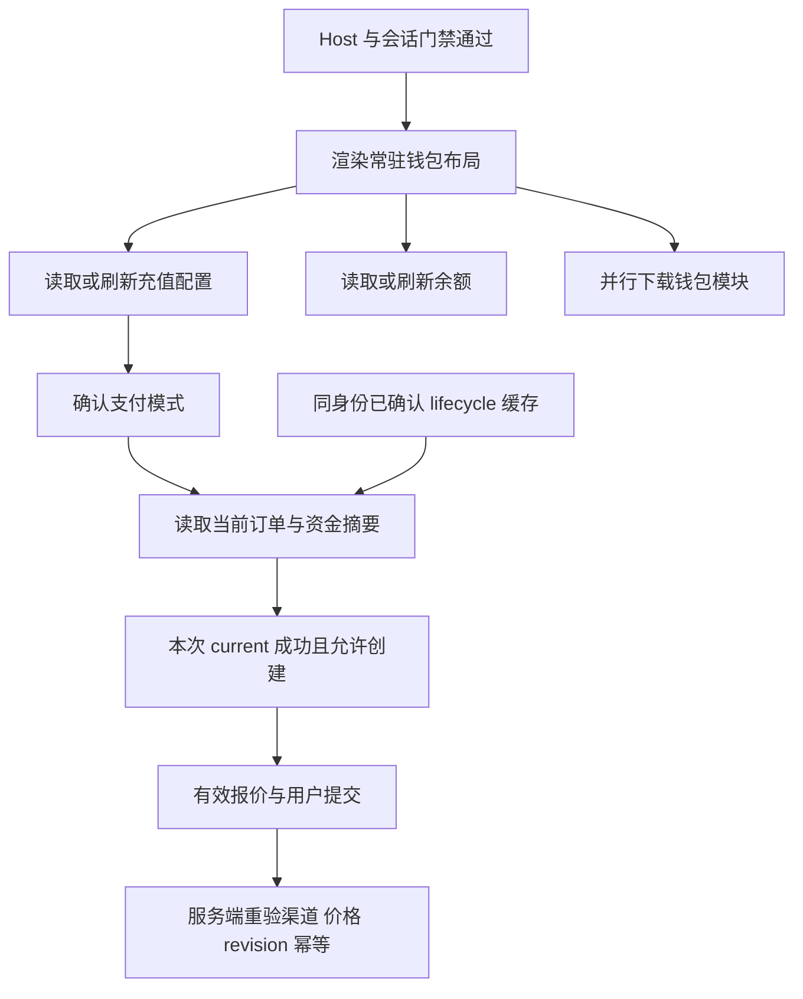

# 钱包首屏加载优化方案（三角色交叉评审）

状态：2026-10-26 实施及定向回归完成，准备按 format 2 独立前端路径发布。初始问题依据原提交与用户截图。当前版本、发布结果和受控浏览器证据保存于本地发布记录，不从本文推断线上状态。

## 结论

采用“常驻钱包概览 + 按身份复用内存缓存 + 独立请求并行 + 支付动作单独确认状态”。本轮优先做前端优化，不修改支付入账、数据库结构或现有支付幂等协议。后端成本问题须先测量再单独处理。

目标是让钱包布局和已有数据不再等待充值配置；首次网络请求仍需真实等待，不能用缓存数字或骨架宣称余额、订单状态已更新。

## 已确认的问题

| 位置 | 当前行为 | 影响 |
| --- | --- | --- |
| `web/default/src/features/wallet/index.tsx:67` | 配置等待与 Suspense 共用整页“恢复订单”提示 | 加载语义错误，内容区空白 |
| `web/default/src/features/wallet/hooks/use-topup-info.ts:168` | 每次挂载从空 state 请求配置 | 离开后返回仍重复挡住全页 |
| `web/default/src/features/wallet/index.tsx:104` | info 返回后才渲染所选 lazy 页面 | 形成 info → 页面模块 → current/余额/摘要 的瀑布 |
| `web/default/src/features/wallet/components/wallet-stats-card.tsx:43` | 摘要刷新失败丢弃已有数据显示；余额等待覆盖整卡 | 独立数据互相阻塞，后台失败导致内容消失 |
| `web/default/src/features/wallet/index.tsx:105` | 根据更新后的 ready 直接替换组件类型 | 可能丢失生命周期 hook 中结果未知请求的原幂等 key、quote、revision |

源码能证明存在瀑布，不能证明截图中数秒分别花在接口、网络或模块下载上。

## 三方意见与取舍

| 角色 | 主要意见 | 最终决定 |
| --- | --- | --- |
| 前端性能架构师 | 移除整页配置门槛；配置、余额及代码下载并行；单一查询 owner | 采纳，保留 lazy，不扩大全局主包 |
| 支付业务与安全架构师 | 缓存只能供展示；新建需本次新鲜 current；组件刷新不能丢 attempt | 采纳，保留报价、revision、幂等与后端重新定价 |
| 产品体验与可靠性负责人 | 加载、检查、恢复语义分开；局部骨架、局部重试；错误不能吞掉已有内容 | 采纳，补齐受影响读取的超时与可访问性 |

交叉评审修正了一项初案：不要求所有用户每次都等待 info 刷新成功。对同一身份已确认的 lifecycle 钱包，本次新鲜 current、有效报价及 Create 的服务端重验已构成支付门禁。把 info 再次设成硬前置会保留原瓶颈。首次模式未知或准备进入旧模式时，仍必须取得新鲜 info。

## 请求与组件分工

1. `WalletPage` 拥有配置和余额查询，常驻标题、概览和历史入口。余额请求与配置请求无依赖，同一轮启动。首次未知数据只显示对应区域骨架。
2. `useTopupInfo` 改用现有 React Query，复用当前配置解析逻辑；不增加 store、持久化缓存或新依赖。Lifecycle 与 Legacy 接收共享余额及刷新回调，删除重复余额 owner。
3. `WalletStatsCard` 仅保留一个实例，拥有资金摘要 query。摘要 API 仅在 lifecycle 能力确认后启用。余额、累计付款分别加载、报错与重试；已有缓存可保留，但必须注明刷新失败或更新时间。
4. `useWalletPaymentFlow` 只在 Lifecycle 中挂载一次，继续拥有 current、回跳订单、自动恢复条件、mutation 与 attempt。父级不调用完整 hook，不重复自动恢复、焦点监听或计时器。
5. 进入钱包时并行预载模块，lazy 与预载复用同一 import promise。已知模式只加载对应模块；未知模式可提前下载 lifecycle 代码，最终使用哪种模式仍由新鲜配置决定。下载代码不挂载组件、不发业务请求。Legacy 在确认需要时加载。
6. 历史入口位置始终保留。模式未确认时可以打开历史区域的加载界面，确认后再选择正确读取格式；不为了按钮可点而猜测接口契约。

## 缓存与支付边界

- query key 沿用 `['wallet-payment', host, tenantId, userId, sid, scope]`。Host、租户、用户、会话尚未确认时不启动私有查询；不把未知 tenant 当作平台租户 0。
- 配置建议 `staleTime: 30_000`、`gcTime: 300_000`、`refetchOnMount: 'always'`。再次进入立即使用已有内容，同时后台去重刷新；这两个时长是实现初值，不是支付授权有效期。
- 配置刷新统一交由 Query 管理，删除原手工 focus/interval 与新配置重复的触发路径；保留旧模式必要的能力探测频率与既有429退避。focus/reconnect不另建一套监听循环，不增加请求风暴。
- 不写 localStorage，不跨身份提供 placeholderData。沿用已有 `installAuthQueryCacheBoundary` 清理机制；token 轮换但 sid 不变不清空缓存。
- GET 支持 AbortSignal；旧身份迟到响应不能更新新身份的展示。身份变化取消对应查询并移除旧数据。
- current 每次挂载必须实际重新读取。设置 `refetchOnMount: 'always'` 并区分“有缓存/isSuccess”和“本次 observer 已成功读取”；仅增加 staleTime=0 不足以证明状态已重新确认。
- 新充值需本次 current 成功、`idle + can_create`、无结果未知 attempt、有效报价及现有操作锁；缓存中的 can_create 不能直接启用按钮。后台查询进行中保留本次已确认资格，不因普通 fetching 反复闪烁或卸载；current 读取失败则阻止新增充值并提供局部重试。
- 已确认 lifecycle、同身份配置后台刷新失败：保留内容，提示渠道列表可能未更新。current 与报价有效时无需等待 info 再成功；报价和 Create 继续在服务端校验渠道、合规、金额及配置变化。
- 首次未知模式、旧模式或缺字段兼容路径：没有本次有效 info 不允许用缓存启动旧支付。暂时故障不代表旧模式可用。
- 新鲜响应明确由 lifecycle 变 false 或能力字段畸形：保留当前组件、订单和 attempt，提示能力异常并暂停支付写动作，仅保留只读刷新；不能自动切到 Legacy。恢复一致能力和新鲜 current 后再放行。旧模式升级也不得在进行中或结果未知操作期间直接换组件。
- 普通配置更新不改组件 key；不能用 loading/error 分支替换整页来清掉原幂等 key。未知创建结果的重试仍复用原 quote、revision、key；本轮不承诺跨完整浏览器重载持久化 attempt。
- 不在悬停、焦点预加载或模块预载中发 POST restore、quote、创建、核实请求。实际进入并满足条件后的既有自动报价保持原流程；restore 仍只在 fresh current 明确报告可恢复订单时执行一次，或由用户主动触发。

## 用户看到的行为

| 场景 | 展示 | 操作边界 |
| --- | --- | --- |
| 首次进入 | 完整布局、余额与充值区各自骨架；余额返回即显示 | 模式和 current 未确认时不允许新充值 |
| 同身份返回钱包 | 立即展示缓存内容，局部显示更新状态 | 本次 current 成功后允许新充值；不因普通 info 慢继续挡整页 |
| 加载当前订单 | 订单区域提示“正在检查充值状态…” | 不把 GET 描述成恢复订单 |
| 实际恢复未完成订单 | 局部提示“正在恢复充值订单…” | 只限制冲突的支付动作，保留概览 |
| 支付回跳 | 回跳订单与 current 独立读取；成功结果不被普通刷新抹掉 | 仍执行既有订单归属、恢复与继续支付校验 |
| 余额或摘要失败 | 有旧值则保留并标记未刷新；无旧值显示暂不可用和重试 | 不伪造 0；不连带阻断有效支付流程 |
| 首次配置失败 | 余额仍可展示，支付区局部报错与重试 | 不进入旧支付兜底 |
| current 或报价失败 | 保留已显示信息，错误和重试靠近对应区域 | current 故障阻止新充值；报价故障阻止对应付款提交 |
| 离线或慢网 | 已有内容保留，首次未知区域有界结束加载并能重试 | 不自动重发支付写请求，不声称到账或状态最新 |
| 换号、换租户、新会话 | 新身份骨架，不能闪现旧身份数据 | 新身份重新完成能力和状态确认 |

普通加载只使用中性文案；真正恢复时才使用恢复文案。局部状态使用 `role=status`/适量 `aria-live=polite`，骨架不重复播报、支持减少动画；真实失败使用可访问错误提示和键盘可用重试。

后台更新不改变输入焦点或清空金额选择；429只播报一次限制和可重试时刻，不把每秒倒计时反复作为alert播报。

## 超时、测量与后端边界

受影响的余额、资金摘要 GET 与报价读取应有明确超时及局部重试，沿用项目现有钱包 20 秒预算作为初值，防止无限骨架。报价虽用 POST，但不得在失败后盲目自动重试或靠预加载制造额外请求。创建、恢复及状态写操作继续按既有未知结果和幂等协议处理，不扩大此次重试范围。

实施前后用受控浏览器 Network/Performance 对比：首次进入、同身份返回、冷模块/热模块、受控慢网。记录钱包布局出现时间、余额显示时间、支付可用时间，及 info/模块/current 的开始与完成顺序。只保存固定 case、相对时长、状态码、请求计数；不保存 Cookie、Authorization、订单号、查询串、响应体或原始 HAR。无真实支付也可验证加载和失败顺序。

不以少量样本推断用户总体 P95，不承诺任意网络条件下秒开，不加入永久遥测系统。

后端已有 canonical schema 检查成功30秒/失败5秒缓存，但 current 路径还有五表 ColumnTypes 探测与订单统计，属于候选成本，尚非已证实瓶颈。若完成前端并行后 current 仍慢，再针对性测量 schema 冷/热检查、锁等待、SQL数和业务查询耗时；依据证据另行设计有界缓存或查询优化。不能直接删除 schema 门禁、盲目增加TTL、增加聚合接口或执行数据库迁移。

## 实施与验收

本轮一次完成前三项：常驻概览和并行加载、配置内存缓存和稳定组件、局部状态及安全门禁。后端优化仅在测量证明有必要时启动。

预计涉及 `wallet/index.tsx`、`hooks/use-topup-info.ts`、`api.ts`、`lifecycle-wallet-page.tsx`、`legacy-wallet-page.tsx`、`components/wallet-stats-card.tsx`、余额共享的小型 hook/props、受影响 API 超时与测试。文案按项目 i18n skill 完成所有语言，不增加支付状态机或无关全局重构。

最小验收场景：

1. 将 info Promise 保持未完成，钱包布局已存在且余额请求已发出；只延迟模式区域，不再出现截图式整页提示。模块下载不排在 info 成功之后。
2. 同身份重新挂载保留缓存可见；同 key 在途请求去重；fresh current 尚未完成或失败时无法新建。不能仅检查缓存 isSuccess。
3. 无可恢复订单时 POST restore 为0；fresh current 明确报告可恢复时执行一次；预加载不发支付写请求。
4. 换用户/租户/sid、旧请求迟到、cached false 后能力升级、首次info错误、true→false/畸形均不串数据或降级支付；配置抖动时 unknown attempt 的原 key 保留。
5. 余额/摘要单项慢或失败不遮住另一项；局部请求超时能结束加载并重试；后台失败保留缓存且标记状态。保留已有回跳、未知创建重试、成功后再次充值回归。

用现有 Vitest/RTL 的可控 Promise 验证顺序和禁用条件，不增加 sleep 型性能测试。执行新增/受影响测试、`bun run typecheck`、改动文件 scoped lint/format、`git diff --check`；不默认跑全仓套件。实际部署时再按适用 runbook 核验发布能力和前端产物，不从本方案推断当前线上状态。

## 实施核验

已实施常驻钱包概览、配置/余额并行读取、提前下载支付模块、身份隔离的 Query 缓存、能力确认后保持生命周期模式、局部加载和失败重试。缓存仅供展示；生命周期支付写入必须等待本次挂载实际 current 网络读取成功，取消查询或手工写缓存不能授权。429 冷却覆盖焦点和重新挂载，离线读取进入明确20秒预算。

配置变 false/畸形时保留同身份原组件和未决 attempt，暂停写入，能力恢复后重新读取 current。旧模式一旦实际发起支付，本次访问保守保持模式；重新进入才允许升级。订阅 checkout 请求返回时再次检查最新能力，暂停后不继续向网关提交，也不把已接受结果报成失败。资金摘要和余额错误不互相遮盖，缓存值保留并标明更新时间。

验证范围为受影响模块和直接关联的支付回跳、订单恢复、幂等保护，不运行全仓完整套件。直接执行的检查包括：

- bun run test src/features/wallet/index.test.tsx：21项通过。
- bun run test src/features/wallet/tenant-wallet.test.tsx：11项通过。
- bun run test src/features/wallet/legacy-wallet-page.test.tsx：3项通过。
- bun run test src/features/wallet/hooks/use-wallet-payment-flow.test.tsx：37项通过，含 Strict Mode、取消读取、未知创建和429。
- API、资金卡、429错误组件、历史订单、订阅购买及回跳专项通过；精确命令与分次结果记录于发布验收文件。
- bun run typecheck、改动文件 scoped oxlint、保留版权头的 scoped oxfmt、bun run i18n:sync 和 git diff --check。
- 新增17条文案已补齐实际7种locale（含zh-TW），原有其它未翻译项不属于此次范围。

受控浏览器基线确认旧版 info 未完成时，只有整页恢复提示且余额请求尚未启动；新版产物将用相同合成数据/请求门控核验。该证据用于验证顺序，不代表线上总体延迟或P95。

真实充值、支付回跳、余额入账及再次充值由用户接手业务测试，代理未验证；不使用模拟测试冒充生产业务验收。纯前端发布不包含数据库、后端镜像、蓝绿后端切流或返利任务的未验收改动。部署最终结果以本次实时版本、资源、缓存、健康与回滚记录为准。
